# Hardwipe Ruleset

**D&D5e, rewired for a cyberpunk table.**

Hardwipe is a Foundry VTT module for running a Cyberpunk-flavoured game on the D&D5e system. Implants live in your real inventory, walls are physical cover that can be shot apart, the GM rules on every attack before it lands, and every roll arrives in chat as a piece of software: readable at a glance, and honest about what happened.

[Install](#install) · [Edge](#edge-one-point-four-plays) · [Player guide](docs/Players.md) · [GM guide](docs/GM.md) · [Braindance](docs/Braindance.md) · [Card gallery](docs/Cards.md) · [Rules reference](docs/Reference.md)

> **Which version is this?** This README describes **0.7.48**, which pairs with **Ready Set Midi 14.0.10.2**. It is the installer published on GitHub; the [release](https://github.com/TobbyClay/hardwipe-ruleset/releases/latest) carries both modules. Install them together. Sections marked **Next release** describe work merged on `main` since then; it ships with the next installer.

## Your body is your loadout

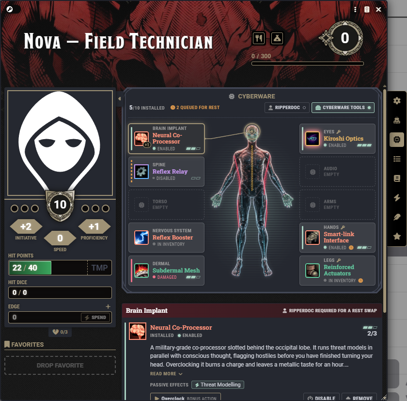

Ten body regions, each holding real inventory items. Installed, working cyberware applies its passive effects; active cyberware puts its D&D5e activities next to your weapons. Charges, damage and service states are visible at a glance, and SC – Item Rarity Colors carries its rarity colours into the slots.

[Set up cyberware →](docs/Cyberware.md) · [Choose a personal paper doll →](docs/Cyberware.md#personal-paper-dolls)

## Your turn, on one tab

| Your turn at a glance | Rolls waiting on you |
| --- | --- |
| 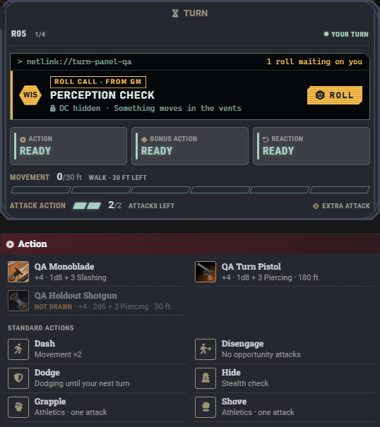 | 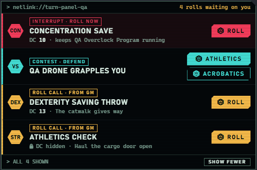 |

The **Turn** tab on the Hardwipe Character sheet shows where you are in the round and what you have left: action, bonus action and reaction, movement and attacks. Below that, one band per cost holds your weapons, implants, spells and the standard actions. Running programs, conditions, Edge and Strikes sit underneath.

- **The netlink.** When the GM asks for a roll, or a contest or a concentration interrupt needs you, the strip at the top lists it with a **Roll** button. It only appears when something is waiting.
- **Reactions that count.** The reaction chip reads Ready Set Midi's markers, or Hardwipe's own ledger, and Shield Block reads it in combat.
- **Was that your reaction?** *(Next release)* An action used off your turn asks whether it was your reaction, and the chip follows your answer.
- **Attack action or Action.** *(Next release)* A weapon swing is one attack of the Attack action; anything that costs the whole action says so on the sheet.
- **Active effects with their clock.** *(Next release)* Buffs show what they grant and a ring that drains with the time left. A GM's own effects work too.

[Read your turn →](docs/Players.md#read-your-turn)

## Crew maneuvers: pull it off together

| The crew sees it | Pull it off |
| --- | --- |
| 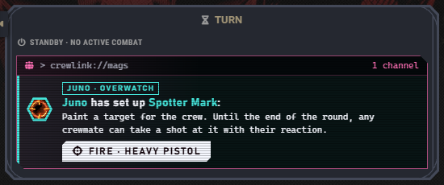 | 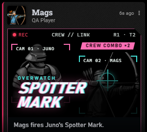 |
| **Set it up: one more Feature Type** | **…or the compact Glitch feed card** |
| 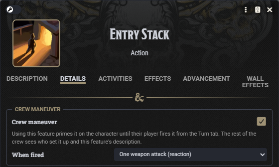 | 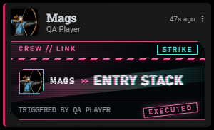 |

One character sets it up; the rest of the crew pays it off. *Entry Stack*: Mags stacks up on a door with a bonus action, Juno kicks it open, and Mags fires as it swings.

- **No new sheet fields.** Set a feat's **Type** to **Crew Maneuver** and pick its maneuver type. What it does is the feature's own description.
- **The crewlink.** Using the feature arms it. Everyone's Turn tab reads *"Mags has set up Entry Stack:"* and the description, with GM secrets left out. Whoever can fire it gets the button.
- **On camera.** Firing posts a CREW card: the crew's camera feeds cut in, two staggered when a crewmate fires someone else's maneuver, with the name in split neon. A compact *Glitch feed* card is a world setting.
- **The GM writes the rules.** **Game Settings → Crew maneuver types** decides what firing does (a weapon attack on the reaction, the feature's own activity, or the card alone), who fires it, and how long it stays armed. Strike, Support and Signal come ready.

[Use crew maneuvers →](docs/Players.md#crew-maneuvers) · [Set up maneuver types →](docs/GM.md#crew-maneuvers)

## Edge: one point, four plays

**Next release:** merged on `main`, not in the 0.7.48 installer yet.

| Spend it | Reroll anyone's die | The GM rules again |
| --- | --- | --- |
| 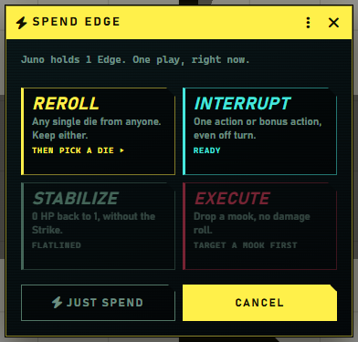 | 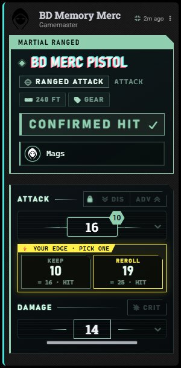 | 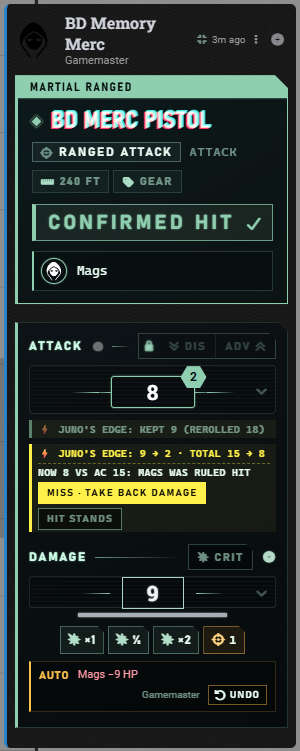 |

Edge is earned by playing it cool, and you hold one at most. **Spend** opens a picker with four plays; one that can't apply right now is greyed with the reason.

- **Reroll.** Any single die on any card, anyone's: an attack's d20, one die of a spell's damage, a save. The new die rolls at once, and both results sit on that card until you keep one. Everything downstream follows: applied damage is adjusted, a save that flips moves its target to saved or failed, and an attack the GM already ruled on goes back to the GM.
- **Interrupt.** One action or bonus action, even on someone else's turn. The Turn tab holds it until you use it or the turn moves on.
- **Stabilize.** From 0 back to 1 HP, Downed cleared, and the Strike from going down taken back.
- **Execute.** A targeted mook drops with no damage roll. Anything with Legendary Resistance is immune.

Each play posts its own cut-in card, and an award posts **Charged**.

[Spend Edge →](docs/Players.md#edge-strikes-and-downed) · [What the GM handles →](docs/GM.md#edge) · [Every Edge card →](docs/Cards.md#edge-plays)

## Every card from one family

**Next release:** merged on `main`, not in the 0.7.48 installer yet.

| Initiative | Consumables | Tools | Features |
| --- | --- | --- | --- |
| 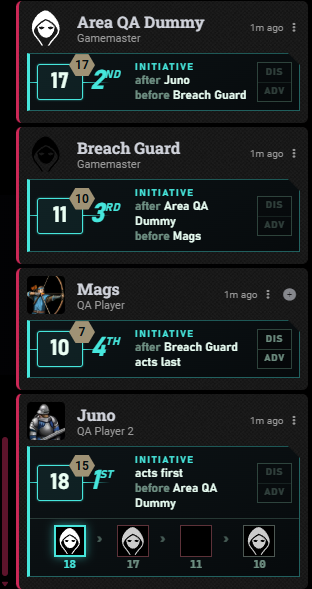 | 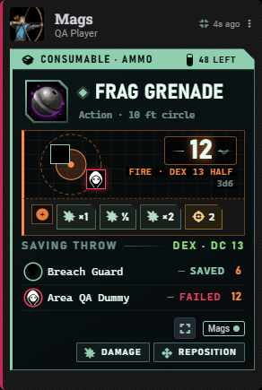 | 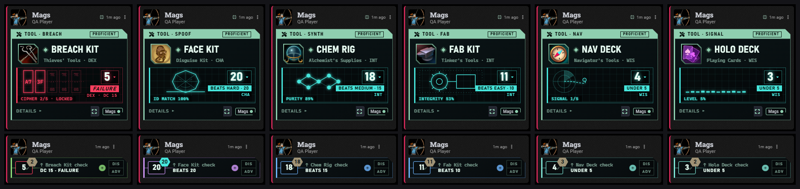 | 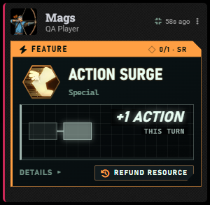 |

- **Initiative** shows your place in the turn order, and it updates as everyone else rolls.
- **Consumables and features** read as one card. A heal draws a vitals trace, a grenade its blast and damage per target, and a buff what it grants and for how long.
- **Tools** have a **Roll check** button. The result lands on the tool card in a scope drawn by its family (Breach, Spoof, Synth, Fab, Nav, Signal). Most rolls have no DC, so the card names the highest standard DC the total beats.
- **Action Surge** gives the action back on the Turn tab.
- **Ready Set Midi's +** (Bless, Guidance, any bonus) stays on every roll.
- **Downed, Flatline, Edge spent and plain rolls** join the family too. A Downed card offers its owner **Stabilize** while they hold Edge.

[Card gallery →](docs/Cards.md)

## Chat that reads like comms

**Next release:** merged on `main`, not in the 0.7.48 installer yet.

| The feed | Light mode |
| --- | --- |
| 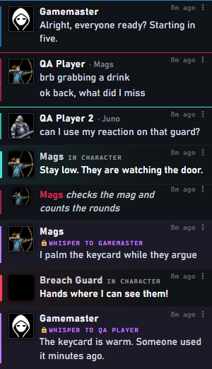 | 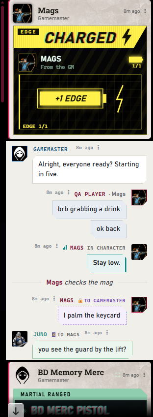 |

What people type reads as a comm feed. It has portraits and cut-corner bubbles, your own messages on the right, and a run of messages grouped under one name line.

- **Public** (Foundry's default chat mode) is the plain bubble.
- **In character** gets a cyan edge, red for NPCs.
- **An emote** is a line across the feed.
- **A whisper** is a dashed violet bubble that says who it went to.
- **Smartphone Widget** texts show up as phone texts, to whom and in the sender's colour.
- **Light mode works.** Typed chat turns light, while Hardwipe's cards stay dark terminals and readable in both schemes.

[Chat modes →](docs/Players.md#chat) · [Card gallery →](docs/Cards.md#typed-messages)

## Roll calls: the GM asks, the crew answers

| Ask | The crew rolls as one | Contests |
| --- | --- | --- |
| 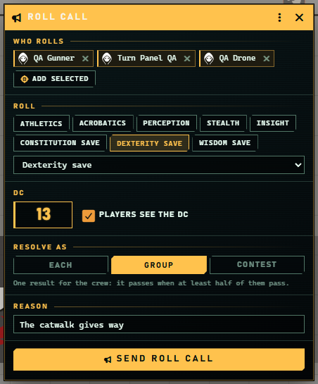 | 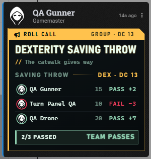 | 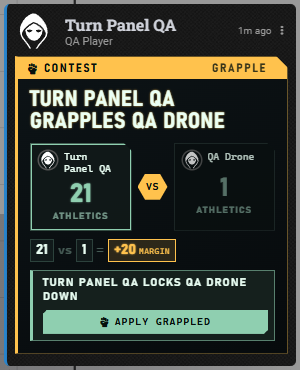 |

**Alt+R** opens the GM's **Roll call** window. Pick who rolls, the check or save, a typed DC that players see or don't, and a reason. It resolves as **Each**, as a **Group** (the crew passes when at least half of them pass) or as a **Contest**.

- **Answered from the sheet.** Players roll from the netlink strip, or roll the same check from their sheet.
- **The comms queue.** The GM's **Queue** tab lists every open request, who still owes it and when it closes, with auto-close settings.

[Run roll calls →](docs/GM.md#roll-calls) · [Answer one →](docs/Players.md#roll-calls-and-contests)

## Attack Rolls are now stylish

| Player attack | Private GM review |
| --- | --- |
| 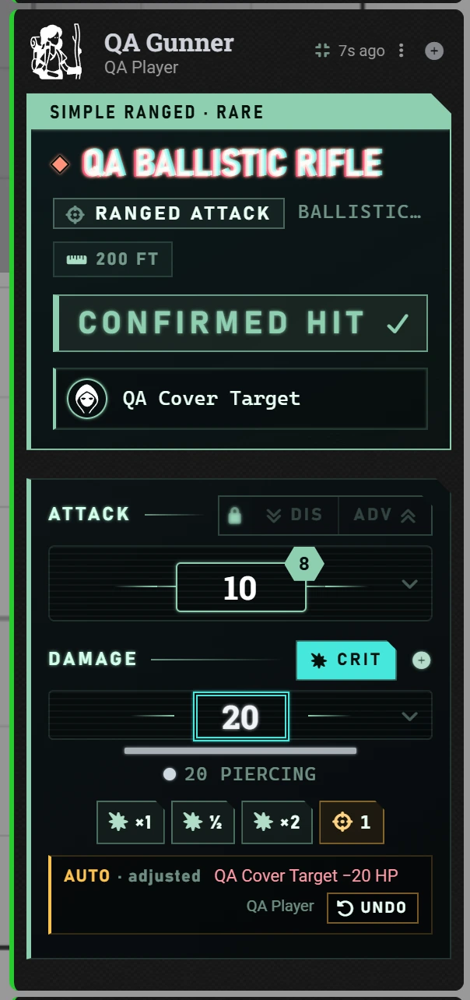 | 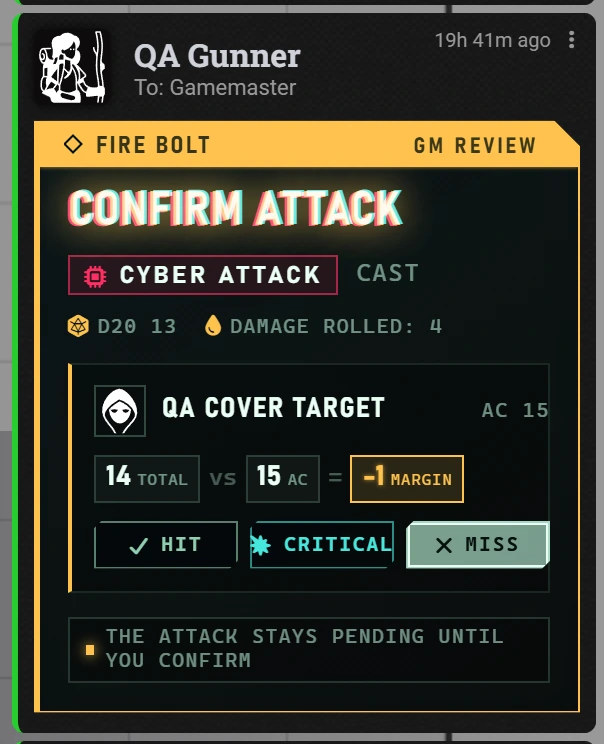 |

When a player attacks, the GM sees the total, the target's AC (cover included) and the margin, and confirms **Hit**, **Critical** or **Miss** for each target. Damage and on-hit effects wait for that call.

- **No flicker.** The attack card stays out of the chat log while Ready Set Midi rolls, checks hits and rolls damage, then appears once, complete, reading *Awaiting GM*. The GM's review appears with it.
- **Damage you can take back.** Damage applied by the workflow is logged on the card as **Auto**, with an **Undo** that restores the hit points. The damage row (×1, ½, ×2, Targets) logs its applications the same way.
- **Rolls you can change.** Switch a pending attack to advantage, add a bonus, reroll a die or roll critical damage, and everything downstream follows. The GM gets a fresh review, a wall proposal still waiting for the GM is re-posted, and damage that was already applied is adjusted by the difference (*Auto · adjusted*). Undo still restores the original hit points. A natural 20 that only arrives with advantage counts as a critical.
- **CRIT on the damage line.** The roller can roll critical damage (the damage dice again) until the GM rules; the GM can at any time. The GM's review notes when the roller added crit dice.

[Combat, damage and shields →](docs/Combat.md) · [Edge, Strikes and Downed →](docs/Players.md#edge-strikes-and-downed)

## Saving throws on a dial

| Saved by a bonus | Natural 20 | Natural 1 |
| --- | --- | --- |
| 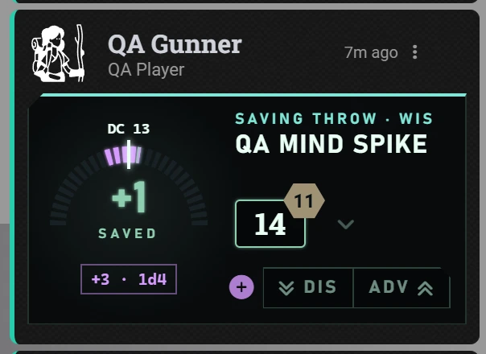 | 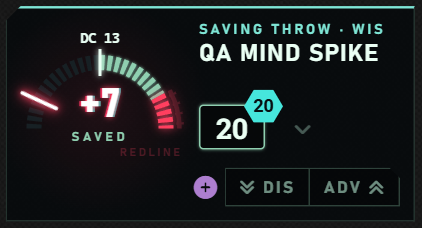 | 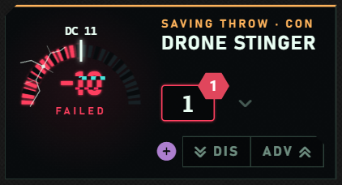 |

A saving throw reads like a gauge. The DC sits at the top of the arc. The reading sweeps right of it by how much the save cleared, or falls short to the left, and the middle shows the difference over **Saved** or **Failed**. Beside the dial are what forced the save, the roll, the **+** button and the DIS / ADV switch.

- **Bonuses after the roll.** **+** adds Bless, Guidance or any formula. The bonus shows as a violet chip and a violet slice of the arc, and the verdict re-reads.
- **Advantage and disadvantage.** Both dice sit side by side, the kept one first and the dropped one dashed. The switch changes the roll after the fact.
- **Natural 20 and natural 1.** A natural 20 pegs the reading into a redline and the needle bounces off the limiter. A natural 1 cracks the gauge. The motion plays once, on a fresh roll, and never with reduced motion turned on.
- **No DC.** A save rolled from the sheet has no verdict. The arc runs from the lowest total the character could roll to the highest, and the middle shows the total.

## Spells and features that ask for saves

| GM rolls NPC saves from the card | One effect, chosen by the caster |
| --- | --- |
| 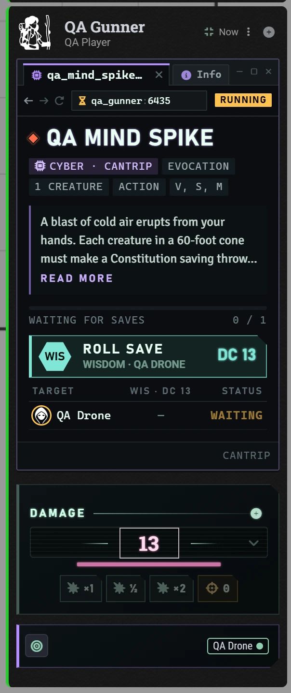 | 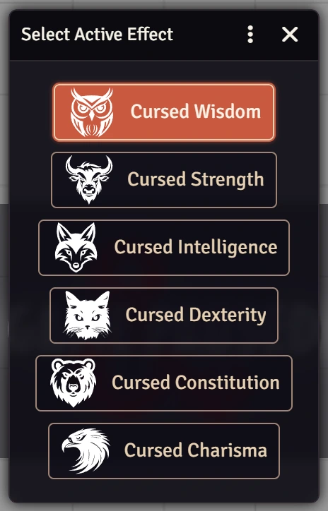 |

A spell, implant or weapon that forces a save lists every target with **Waiting**, **Saved** or **Failed**. Whoever owns a target that still has to roll gets a **Roll save** button in the ability's colour. The GM gets the same button for the NPC targets.

- **NPC saves wait for the GM.** On first load, Hardwipe switches Ready Set Midi's **Roll NPC saves** from *Auto* to *Chat Message*, once per world. Without that switch, Midi rolls NPC saves the instant a spell lands and the button never appears. Midi's own one-line save request is hidden, because the card's button replaces it. If you prefer automatic NPC saves, switch the setting back; Hardwipe will not change it again.
- **Effects that are alternatives stay alternatives.** Some activities carry one effect per option: Bestow Curse has a curse per ability, Blindness/Deafness has both conditions. When an activity carries several effects for its targets, the caster now picks the one that lands, instead of Midi applying all of them. The world setting **Choose one effect when an activity has several** turns this off.

[Saving throws in detail →](docs/Combat.md#saving-throws)

## Know why a shot had advantage

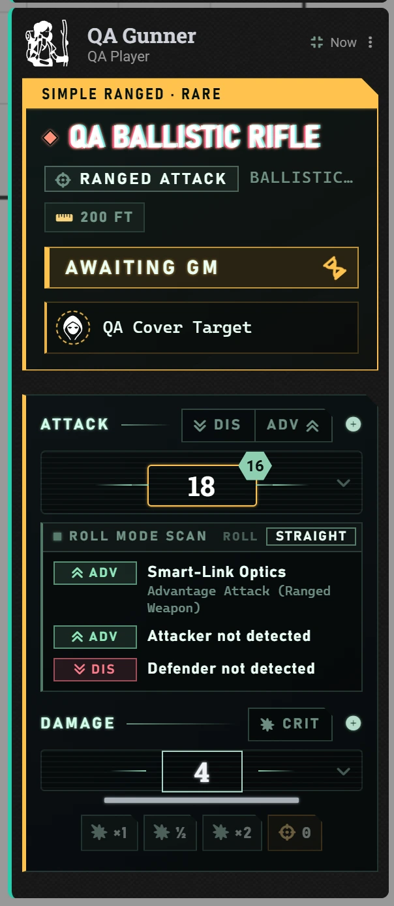

You choose the roll mode for ranged attacks. Under the attack roll, the **roll mode scan** lists every advantage or disadvantage source Ready Set Midi actually evaluated, with the rule each came from, and says which mode to roll: **ADV**, **DIS** or **Straight**. Advantage and disadvantage cancel, and a blocked source is struck through. If nothing was found, no box appears.

[Ranged hints and their limits →](docs/Combat.md#ranged-hints-name-the-actual-source)

## Cover that changes the fight

| Configure a wall | Damage you can see through |
| --- | --- |
| 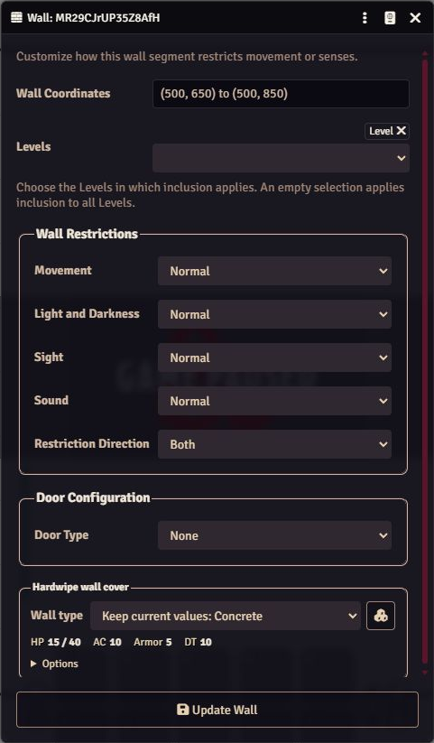 | 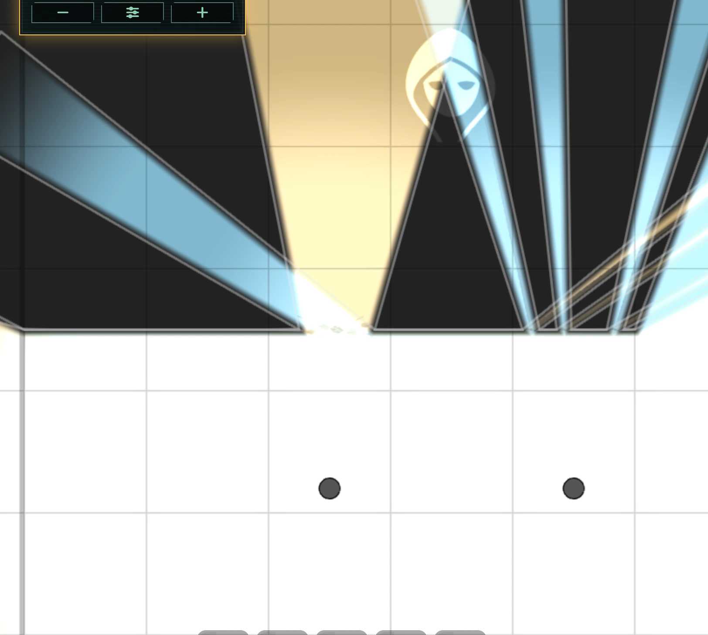 |

Walls provide ranged cover. Give them a type, HP per five-foot section, armor and a damage threshold. Shots that miss because of cover hit the wall; players can also target a wall section directly. Either way, the GM approves the damage with **Apply damage** or **Ignore**.

- **Each hit leaves its own hole.** A big hit makes one wide hole, and several small hits make several small, scattered ones. The holes let sight, light and shots through, so players can glimpse what's behind and a target lined up with a hole has less cover. The wall still stops movement until a section reaches zero and opens a five-foot breach.
- **Undo last wall damage** restores HP, holes and breached geometry together.
- **Area spells damage walls.** Fireballs, cones, lines, cubes, emanations and rings hit every wall section they reach, set per spell or as a default for each shape, with the same GM approval.

[Configure and fight around walls →](docs/Walls.md)

## Concentration is a running program

| Interrupt | Recovered | Crashed |
| --- | --- | --- |
| 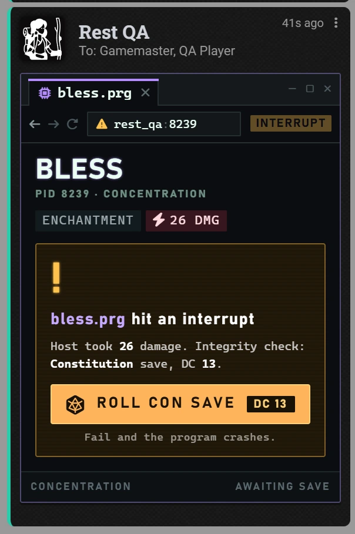 | 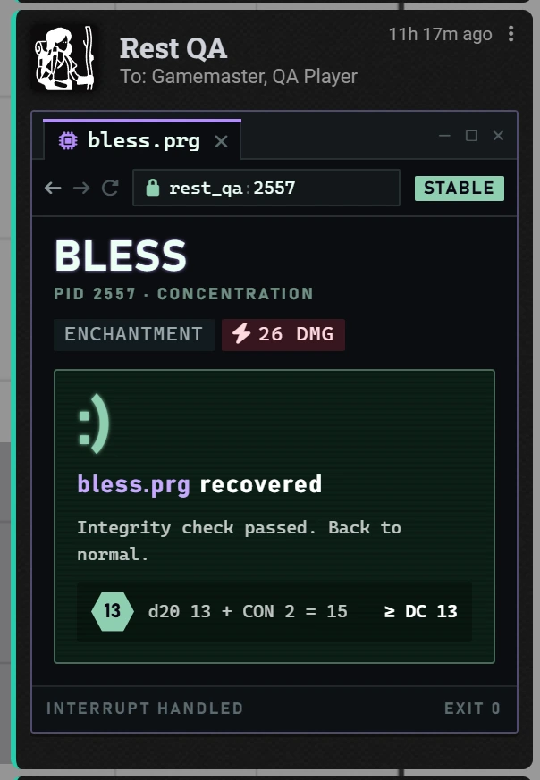 | 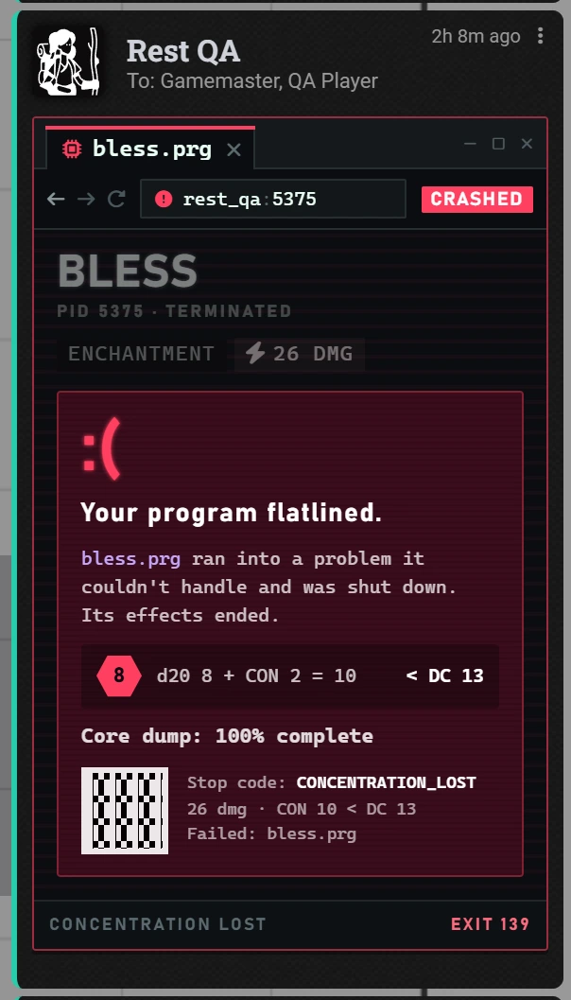 |

Taking damage while concentrating interrupts the running program and asks for a Constitution save. A success recovers it; a failure crashes it.

[Concentration controls →](docs/Combat.md#concentration)

## Rest at the safehouse

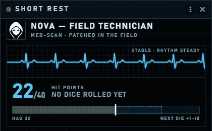

Spend Hit Dice one at a time and watch the med-scan climb. Use rest abilities like Arcane Recovery from the same window, then send one receipt to chat. Queued implant swaps complete when the rest and service requirements are met.

[Take a rest →](docs/Rests.md)

## Raise the Heat

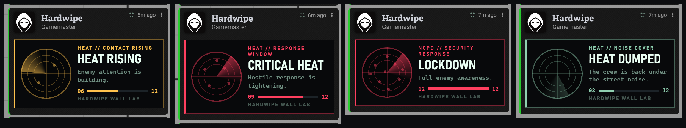

A scene-level Heat meter tracks how loud the crew has been. Each mission picks how Heat is announced: **Threat broadcast**, **Corrupted feed** or **Police scanner**. A world setting picks one of three turn-start card styles. Card colours are configurable, and motion stops for anyone with reduced motion turned on.

[Mission Heat and interface settings →](docs/GM.md#mission-heat)

## High Rollers: every roll, on the record

| The session at a glance | The Screamsheet recap |
| --- | --- |
| 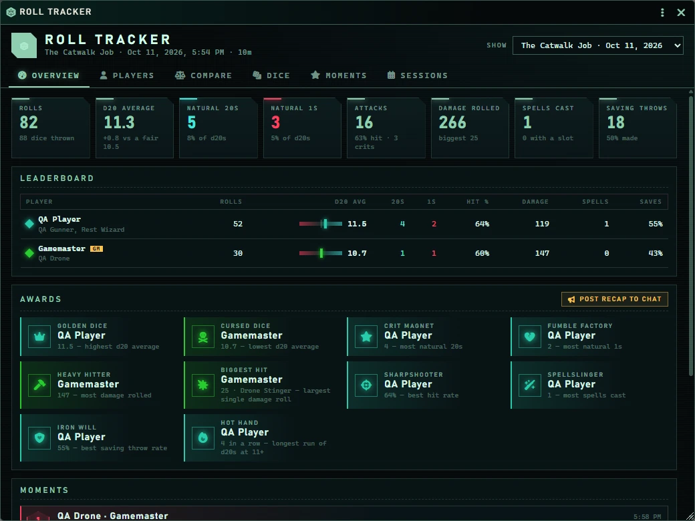 | 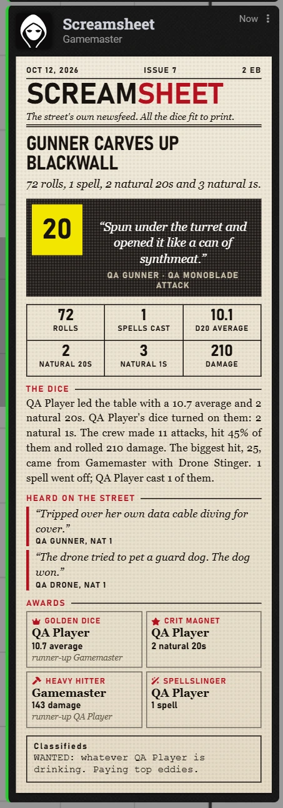 |

**Game Settings → Hardwipe Ruleset → Roll Tracker** counts every roll that reaches chat, per player and per session: rolls and spells cast, d20 average, natural 1s and 20s, attacks and hit rate, damage and the biggest hit, healing, saves, checks, initiative, and Hardwipe's downs, flatlines and Edge.

- **The GM runs the sessions.** When the GM loads the world after a break, a dialog asks whether tonight is a new session and what to call it. Every session's name, number and times stay editable, and the rolls follow the times.
- **Players and characters.** Each player gets a character screen: their numbers as attribute hexes around their d20 average, their d20 faces, spells, rolls per session and roll types. Compare puts any two side by side, item-comparison style.
- **Awards.** Sixteen of them, from Golden dice and Crit magnet to Fumble factory and Glass jaw, each with its runner-up.
- **Natural 1s and 20s.** A small box beside the chat asks the GM what was happening; the note stays with the roll.
- **Post recap and Show players.** The GM posts the session as a Screamsheet to chat, or opens the tracker on every player's screen.

[Roll Tracker guide →](docs/GM.md#roll-tracker)

## Braindance: play someone else's memory

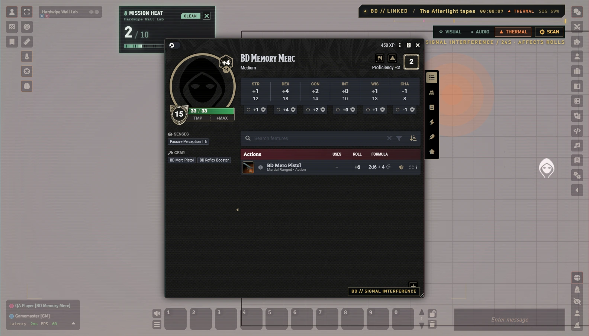

The GM pairs each player character with an NPC and enters a memory. Players keep playing, with the NPC's full sheet, implants and token, under a synchronized overlay. When the memory ends, everyone gets their character back.

- **Memory isn't reality.** Wall damage, breaches and Mission Heat from the memory roll back when it ends, unless the GM keeps them.
- **Layers and clues.** Switch between Visual, Audio and Thermal, follow a clue's trace and scan it to reveal it.
- **Sensory echoes that bite.** Panic, Disorientation, Interference and Overload can impose disadvantage or knock an implant offline.
- **Timeline and replays.** Mark moments and rewind everyone to one.
- **On the record.** Cards rolled in a memory carry a BD stamp, and the Roll Tracker credits the real character.

| The GM hides clues on a layer | The player scans and finds one |
| --- | --- |
| 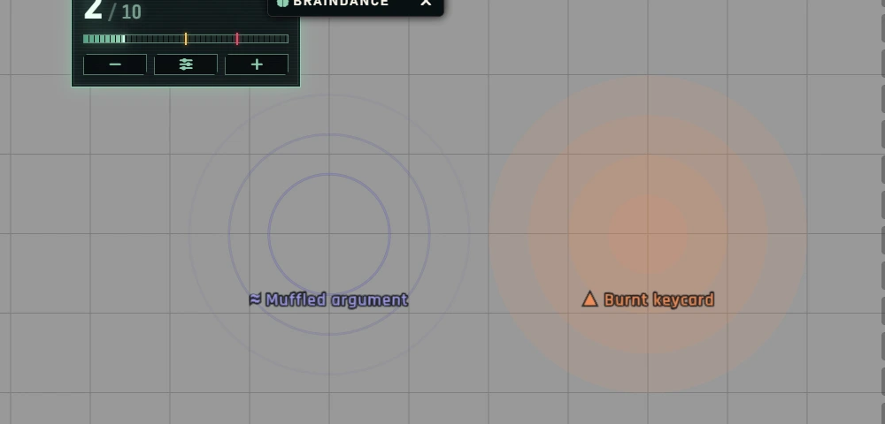 | 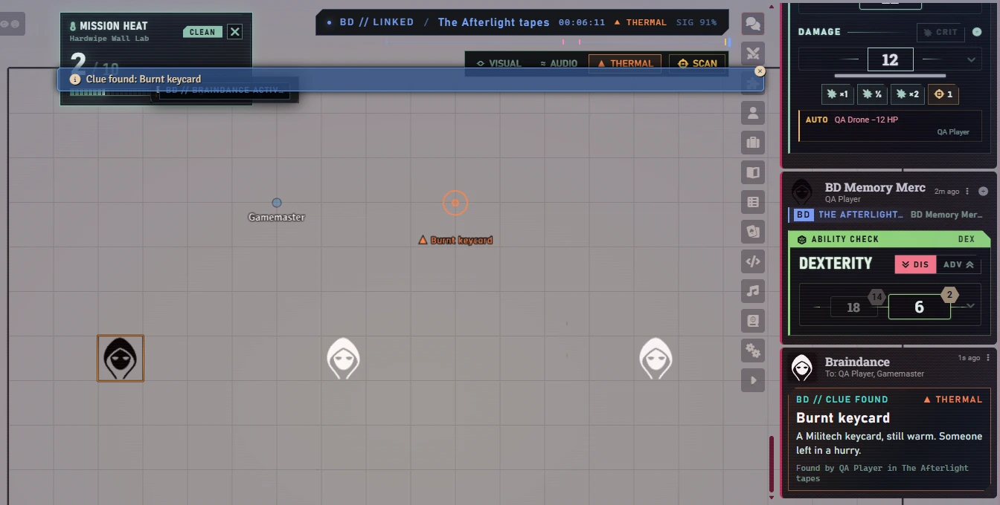 |
| **The console** | **Hiding a clue** |
| 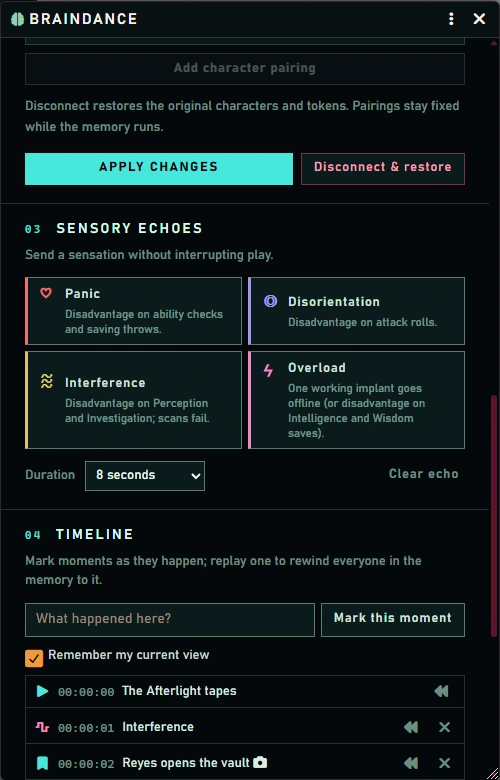 | 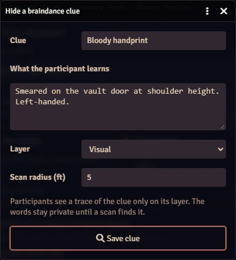 |
| **Every roll is stamped** | **…and credited to the real character** |
| 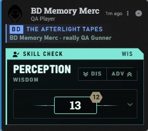 | 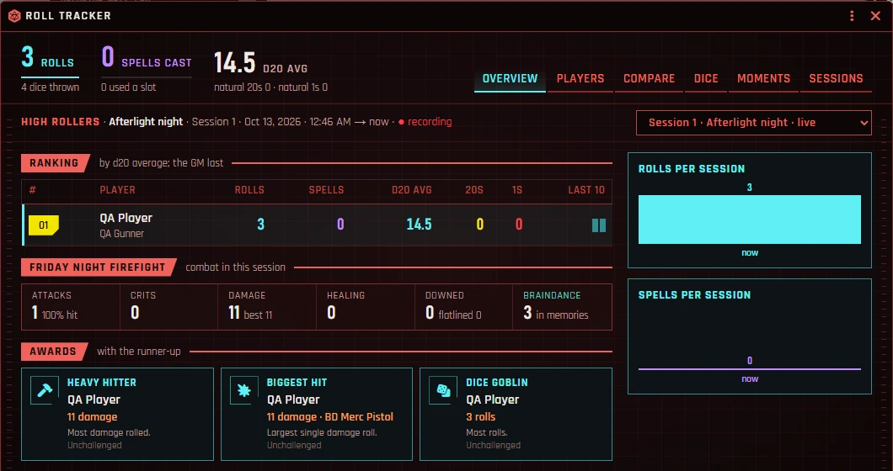 |

### Set it up

1. **Install Hardwipe 0.7.48 with its Ready Set Midi** (see [Install](#install)). Braindance is built in; there is nothing else to enable.
2. **Coming from Braindance Suite?** Restore any running memory with it, then disable that module. While it is enabled, Hardwipe's Braindance stays switched off and tells the GM why.
3. **Prepare the memory bodies.** Create or import the NPCs into the **Actors** directory; compendium NPCs must be imported first. Give them the weapons, spells and implants the players should have. Installed cyberware works like it does on a character.
4. **Check who plays whom.** Each player character must be assigned to its player (**User Configuration → Character**) or owned by them.
5. **Choose the echo default** (optional). **Game Settings → Hardwipe Ruleset → Braindance echoes affect rolls by default** decides whether echoes start with mechanical effects.
6. **Hide clues ahead of time** (optional). Open Braindance from the **brain** button in **Token Controls** (or **Alt+B**). In **Clues in this scene**, press **Hide a clue**, click the spot on the map, then give it a name, what the participant learns, a layer and a scan radius.

### Run a memory

1. In the console, name the memory and pick a mood and intensity.
2. Pair each player character with the NPC they become.
3. Under **When the memory ends**, keep **Memory isn't reality** to roll walls and Heat back, or choose **Keep what happened**.
4. Press **Enter memory**. Players' NPC sheets open and their tokens change on every scene.
5. Play. Send echoes and mark moments from the console; replay a moment to rewind everyone to it.
6. Press **Disconnect & restore**. Characters, sheets and tokens come back, and walls and Heat roll back if you chose that.

| Key | Does |
| --- | --- |
| **Alt+B** | Open the Braindance console (GM controls, everyone's comfort settings) |
| **Alt+L** | Next editing layer: Visual, Audio, Thermal |
| **Alt+S** | Scan: the next click on the map reads that spot |
| **Alt+Shift+B** | Hide or show the Braindance visuals on your own screen |

[Braindance guide →](docs/Braindance.md)

## Install

Built and tested on **Foundry VTT 14.367 · D&D5e 6.0.5 · Ready Set Midi 14.0.10.2**.

1. In Foundry Setup, open **Add-on Modules → Install Module**.
2. Paste this manifest:

   ```text
   https://github.com/TobbyClay/hardwipe-ruleset/releases/latest/download/module.json
   ```

3. Install the **Ready Set Midi** build from the same release, plus libWrapper, socketlib and DAE. Enable all five with Hardwipe Ruleset.
4. Disable standalone Midi-QOL and Ready Set Roll; the fork replaces both. Give characters the **Hardwipe Character** sheet.

**What Hardwipe changes in your world on first load:** Ready Set Midi's **Roll NPC saves** moves from *Auto* to *Chat Message*, once, so the GM rolls NPC saves from the card. You'll see a notice when it happens.

[Downloads and release notes](https://github.com/TobbyClay/hardwipe-ruleset/releases/latest) · [Detailed setup and troubleshooting](docs/GM.md#installation-and-first-run) · [Report a problem](https://github.com/TobbyClay/hardwipe-ruleset/issues)

## Find the right guide

| I want to… | Open |
| --- | --- |
| Play a character, read your Turn tab, fire crew maneuvers, spend Edge, or chat in and out of character | [Player guide](docs/Players.md) |
| Install or swap implants, use rarity colours, or change the doll | [Cyberware](docs/Cyberware.md) |
| Roll Hit Dice, recover slots, or read a rest receipt | [Rests](docs/Rests.md) |
| Review attacks, apply and undo damage, roll saves, or keep concentration | [Combat](docs/Combat.md) |
| Give walls HP, set thresholds, target sections, or undo a breach | [Walls](docs/Walls.md) |
| Set up a world, Mission Heat, roll calls, crew maneuver types, colours, text size, or folding | [GM guide](docs/GM.md) |
| Run a memory, hide clues, send echoes, or replay a moment | [Braindance](docs/Braindance.md) |
| See every card family side by side | [Card gallery](docs/Cards.md) |
| Look up exact cover rules, integration fields, or known limits | [Rules reference](docs/Reference.md) |

Every image here is a real Foundry capture from a synthetic test world, cropped or resized for reading. The [media notes](docs/Media.md) list which version each one comes from. They show the interface; they don't promise that every combination of modules has been tested.
