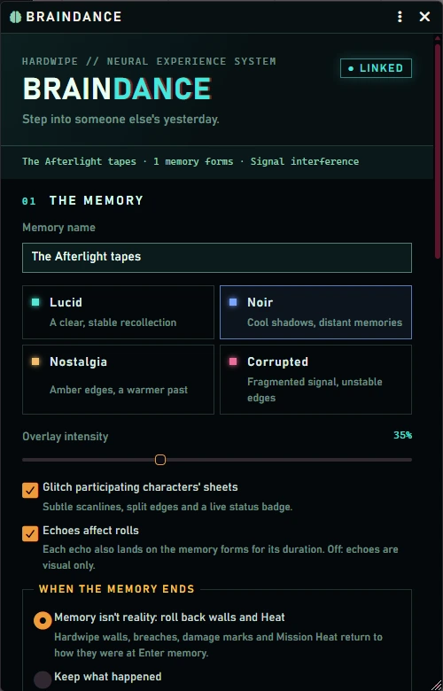
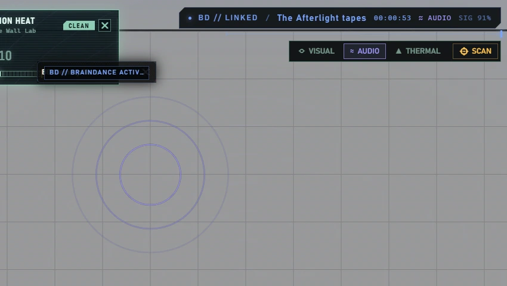
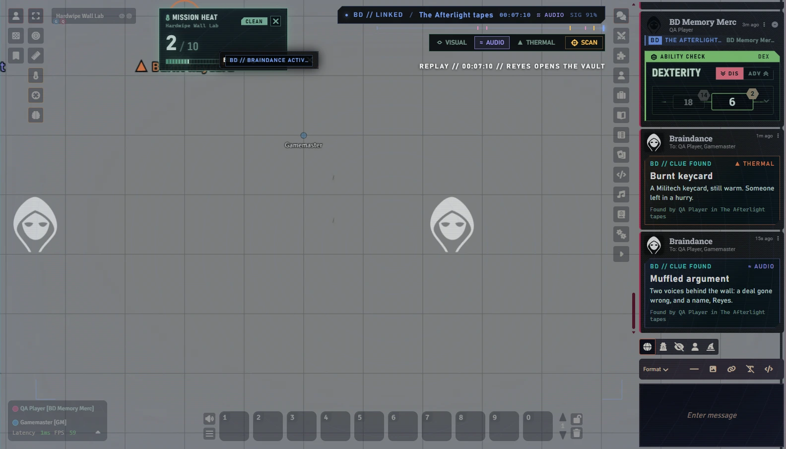

# Braindance

Play through a memory inside someone else's body. The GM pairs each player character with an NPC and enters the memory: every participant keeps playing normally, but with a full copy of that NPC's sheet, implants and token, under a synchronized overlay. When the memory ends, everyone gets their character back, and the world can forget what happened in it.

Braindance came from the standalone **Braindance Suite** module and is built into Hardwipe from 0.7.47. See [Moving from Braindance Suite](#moving-from-braindance-suite).


## Run a memory

Open the console from the **brain** button in **Token Controls** (GMs always see it; players only while a memory runs), with **Alt+B**, or from **Game Settings → Hardwipe Ruleset → Open Braindance**.

| The memory | Timeline and echoes |
| --- | --- |
|  |  |

1. **Name the memory and pick a mood:** Lucid, Noir, Nostalgia or Corrupted, plus an overlay intensity.
2. **Pair characters.** Choose each player's character and the NPC they become. Players assigned to that character take part; if nobody is assigned, its non-GM owners do. NPCs from compendiums must be imported into the Actors directory first.
3. **Choose what happens when it ends** (see [Memory isn't reality](#memory-isnt-reality)).
4. **Enter memory.** Each participant gets a temporary copy of their NPC: stats, items, implants, effects, portrait and token. Their NPC sheet opens; their placed tokens switch on every scene. Everything else plays as usual: Hardwipe attack reviews, cover, saves and damage all work on the NPC form.
5. **Disconnect & restore** gives everyone their character, sheets and token appearance back. Token movement during the memory is kept.

A GM-only journal records the original assignments before anything changes. If a write fails, or the GM refreshes mid-memory, **Restore characters** finishes the job.

## Memory isn't reality

By default, a memory leaves no marks on the world. When the memory ends, Hardwipe puts back, on every scene, what it recorded at **Enter memory**:

- **Walls:** cover walls, their section HP, breaches (a breached wall comes back with its own ID) and the damage marks and glimpse holes.
- **Mission Heat.**
- **Wall records:** the wall undo history and the damage ledger.

Choose **Keep what happened** in the console instead and the changes stay. The choice can be changed while the memory runs, and every new memory starts on rollback again. Walls and Tiles without Hardwipe data are never touched, and NPC hit points outside the memory forms are not part of the rollback.

## Sensory echoes

Send **Panic**, **Disorientation**, **Interference** or **Overload** for 5 to 60 seconds. On screen they are tints, pulses and signal tears. With **Echoes affect rolls** on, they also land on every memory form for their duration:

| Echo | Effect on the memory forms |
| --- | --- |
| Panic | Disadvantage on ability checks and saving throws. |
| Disorientation | Disadvantage on attack rolls. |
| Interference | Disadvantage on Perception and Investigation; braindance scans fail. |
| Overload | One working implant goes offline until the echo ends; a form with no implant gets disadvantage on Intelligence and Wisdom saves. |

The effects are read by Ready Set Midi and removed when the echo ends, is cleared or replaced, or the memory ends. The world setting **Braindance echoes affect rolls by default** sets the starting choice for new memories.

## Layers and clues

Like a braindance editor, participants can switch between three layers from the deck at the top right of the screen (**Alt+L** cycles them):

- **Visual:** outlines and shapes.
- **Audio:** sound sources ripple.
- **Thermal:** heat signatures bloom, and the screen takes on a thermal tint.



The GM hides clues with **Hide a clue** in the console: click the spot, then give it a name, what the participant learns, a layer and a scan radius. Participants see a clue's trace only on its layer. **Scan** (or **Alt+S**), then click the canvas:

- **On the right layer and within the radius:** the clue is found. Its name appears on the canvas, and the participants and GM get a clue card with what was learned. The find goes on the timeline.
- **A trace on another layer:** the scan says which layer to switch to.
- **During an Interference echo that affects rolls:** the scan fails.


Scans are checked by the GM's client. **Hide found clues again** resets a scene for another group. The clue's words stay in a GM-only journal until it is found. Like any hidden journal in Foundry, that keeps them out of players' screens, but the data still reaches every client.

## Timeline and replays

The HUD shows how long the memory has run, with a strip of ticks for its moments. The console's timeline lists them:
- the memory's start;
- every echo;
- every clue found;
- moments the GM marks with **Mark this moment**, optionally remembering the GM's current view.

**Replay** rewinds everyone in the memory to a moment for a few seconds. The overlay takes that moment's mood and echo, the HUD reads *REPLAY // time // label*, and participants' canvases pan to the remembered view when it is on their scene.



## Chat and the Roll Tracker

Every card rolled by a memory form carries a **BD** stamp with the memory's name, the form and the real character ("BD Memory Merc · really QA Gunner"). Hardwipe cards keep their full behaviour.

The [Roll Tracker](GM.md#roll-tracker) credits those rolls to the participant's real character, not to the temporary form, and tags them as memory rolls. The firefight strip shows a **Braindance** count when a session has any.

## Comfort controls

Everyone has local comfort controls in the console: visuals on or off (**Alt+Shift+B**), their own strength, reduced motion and sheet glitches. Turning visuals off doesn't change the form they play. GMs can preview the participants' view. Motion stops with the operating system's reduced-motion setting.

## Moving from Braindance Suite

If the standalone **Braindance Suite** module is still enabled, Hardwipe's Braindance stays switched off and tells the GM so. Restore any running memory with Braindance Suite, then disable that module. Its settings and recovery journal are separate; there is nothing to migrate.

## Macro API

```js
const bd = game.hardwipe.braindance;
await bd.start({
  label: "The Afterlight tapes",
  pairings: [{ characterUuid: "Actor.CHARACTER_ID", npcUuid: "Actor.NPC_ID" }],
  preset: "noir", intensity: 35, mechanics: true, reality: "rollback"
});
await bd.cue("interference", 15);            // panic, disorientation, interference, overload
await bd.mark({ label: "Reyes opens the vault" });
await bd.replay(bd.getState().markers.at(-1).id);
await bd.stop();                              // or bd.stop({ reality: "keep" })
```

`open()`, `scan()`, `setLayer(layer)` and `clues.list() / place() / edit(id) / remove(id) / reset()` are also available. Start, update, echoes, timeline and clue changes need a GM.

## Limits

- **System:** full NPC replacement needs D&D5e.
- **Recovery:** keep the original characters and the recovery journal until the memory ends.
- **Sheets and multi-GM:** third-party sheet replacements, detached sheet windows and two GMs transforming at once are not verified.
- **Restoration:** a character already transformed by D&D5e's own polymorph must be restored before it can enter a memory.
