# Card gallery

[← Overview](../README.md) · [Combat](Combat.md) · [Rests](Rests.md) · [Cyberware](Cyberware.md) · [GM settings](GM.md)

Hardwipe gives each kind of action its own software-inspired display. Click any image to open the full capture. The examples use synthetic characters and scenes, so the QA names are demonstration data.

[Weapons](#weapon-outcomes-and-gm-review) · [Makers](#weapon-makers) · [Spells](#spell-programs) · [Concentration](#concentration-interrupts) · [Checks](#checks-and-initiative) · [Gear](#gear-and-class-features) · [Consumables](#consumables) · [Features](#class-features) · [Tools](#tools) · [Prompts](#prompts) · [Crew](#crew-maneuvers) · [Implants](#cyberware-diagnostics) · [Rests](#short-rest-monitor) · [Chat](#typed-messages) · [Rolls](#plain-rolls) · [System cards](#edge-strikes-and-downed) · [Roll calls](#roll-calls) · [Braindance](#braindance) · [Heat](#mission-heat-styles)

## Weapon outcomes and GM review

Use a weapon activity to make the roll; the GM confirms each target. The verdict, attack dice, damage breakdown, and apply controls share one card. [Combat and approval →](Combat.md)

*Hit, critical and miss: 2026-10-18; critical miss: 0.7.38; GM review: 0.7.43.*

<table>
  <tr>
    <td valign="top"><a href="media/attack-hit-current.png">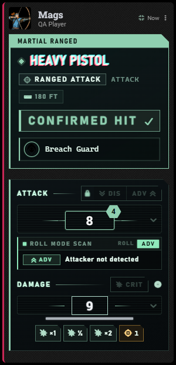</a> <strong>Confirmed hit</strong> The target verdict sits above the attack and damage totals.</td>
    <td valign="top"><a href="media/attack-crit-current.png">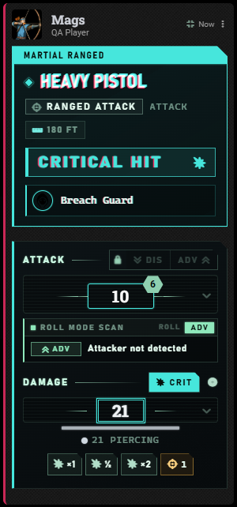</a> <strong>Critical hit</strong> Critical damage, cover, and target status remain visible together.</td>
    <td valign="top"><a href="media/attack-miss-current.png">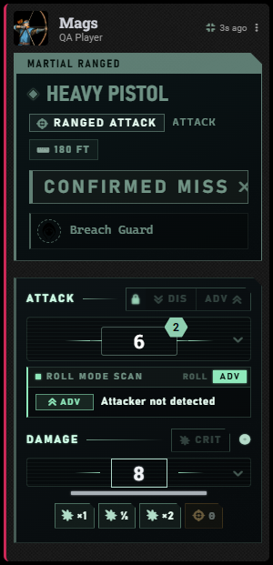</a> <strong>Miss</strong> A missed attack keeps its rolled result and any associated save controls.</td>
  </tr>
  <tr>
    <td valign="top"><a href="media/attack-fumble.webp">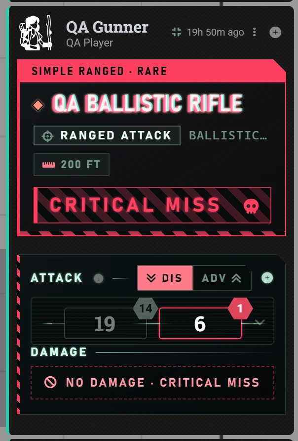</a> <strong>Critical miss</strong> A natural 1 is clearly marked after the GM decision.</td>
    <td valign="top"> <strong>Private GM review</strong> Choose Hit, Critical, or Miss for each target; pending attacks wait for confirmation.</td>
  </tr>
  <tr>
    <td valign="top"> <strong>Damage you can take back (0.7.45)</strong> Damage the workflow applied is logged on the card as Auto, with Undo.</td>
  </tr>
</table>

### Weapon makers

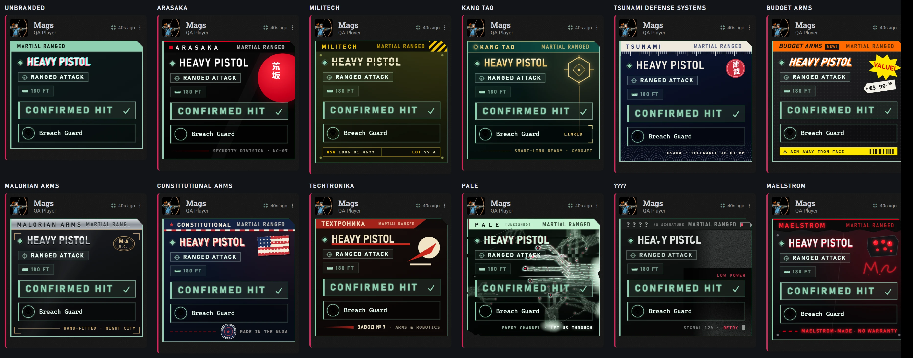

*(Next release.)* Set a weapon's **Manufacturer** on its Details tab and its attack card wears that maker: the bar and wordmark, an emblem behind the head, the title's type, a serial plate, and the roll card's rail. The outcome still reads where it always does: the outline, the verdict strip and the targets keep their hit, miss and critical colours, and a miss fades the brand.

Eleven makers have a style: **Arasaka**, **Militech**, **Kang Tao**, **Tsunami Defense Systems**, **Budget Arms**, **Malorian Arms**, **Constitutional Arms**, **Techtronika**, **Maelstrom**, and the campaign's own **PALE** (circuit hands forcing their way in through a damaged card) and **????** (a card running out of power). Any other maker shows its name on the plain card's bar; no maker keeps the plain card. A card follows the weapon's current maker, so changing it redraws the weapon's cards already in chat.

## Spell programs

Spell activities appear as a running program. Read the output, open Info for the description, and resolve any requested saves. [Spells and saves →](Combat.md#saving-throws)

*Native captures: 0.7.38.*

<table>
  <tr>
    <td valign="top"><a href="media/spell-attack.webp">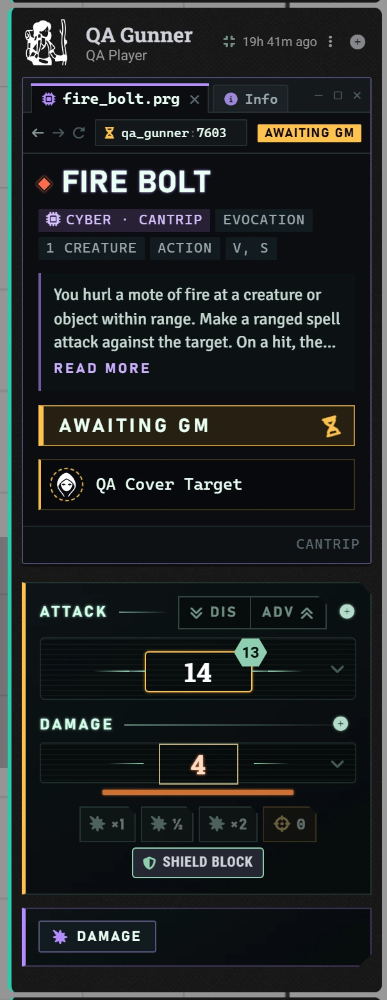</a> <strong>Awaiting GM</strong> A spell attack remains pending until the target outcome is confirmed.</td>
    <td valign="top"><a href="media/spell-hit.webp">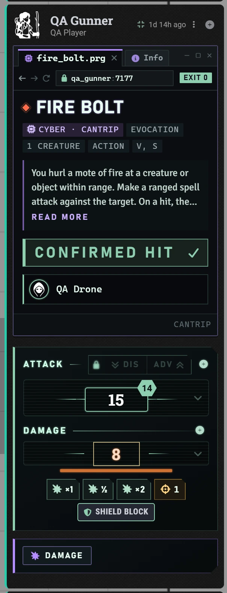</a> <strong>Confirmed spell attack</strong> The program displays its resolved attack and damage.</td>
  </tr>
  <tr>
    <td valign="top"><a href="media/spell-save.webp">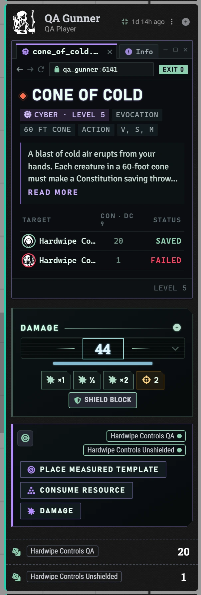</a> <strong>Saving-throw spell</strong> Each target has its own waiting, saved, or failed result.</td>
    <td valign="top"><a href="media/spell-heal.webp">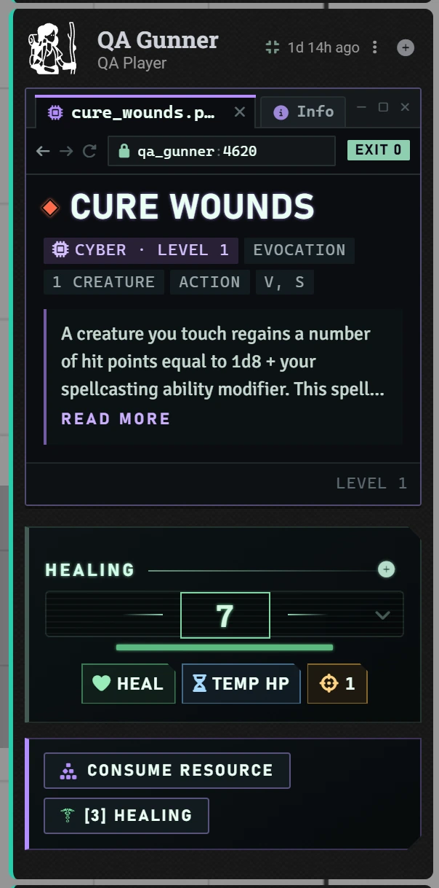</a> <strong>Healing program</strong> Healing keeps its roll and application controls in the spell window.</td>
  </tr>
  <tr>
    <td valign="top"> <strong>NPC saves wait for the GM (0.7.44)</strong> The GM rolls them from the card's Roll save.</td>
    <td valign="top"> <strong>One effect, chosen (0.7.44)</strong> When an activity carries several alternative effects, the caster picks one.</td>
  </tr>
</table>

## Concentration interrupts

Damage interrupts the held program and asks for a Constitution save. Roll from the request; its state changes with the result. These examples show the owner/GM view. [Concentration controls →](Combat.md#concentration)

*Native captures: 0.7.38.*

<table>
  <tr>
    <td valign="top"> <strong>Interrupt received</strong> Roll CON save from the request using the normal roll dialog.</td>
    <td valign="top"> <strong>Recovered</strong> A successful save reports that the program is still running.</td>
    <td valign="top"> <strong>Program crashed</strong> A failed save displays the concentration loss.</td>
  </tr>
  <tr>
    <td valign="top"> <strong>Host offline</strong> An incapacitated host offers End program.</td>
    <td valign="top"><a href="media/conc-ended.webp">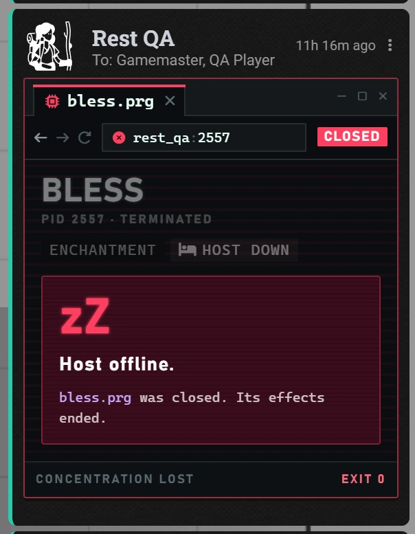</a> <strong>Program closed</strong> The ended state makes an intentional shutdown explicit.</td>
    <td valign="top"><a href="media/conc-save-collapsed.webp">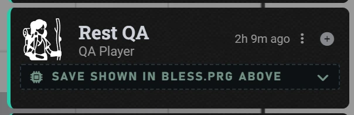</a> <strong>Save folded into the record</strong> The linked save collapses to a compact result after resolution.</td>
  </tr>
</table>

## Checks and initiative

Skills, abilities, saves, initiative, and concentration saves share readable roll totals and natural-die badges. Open the total for the dice breakdown. [Roll controls →](Combat.md#read-and-apply-a-roll)

*Native captures: 0.7.38.*

<table>
  <tr>
    <td valign="top"><a href="media/check-skill.webp">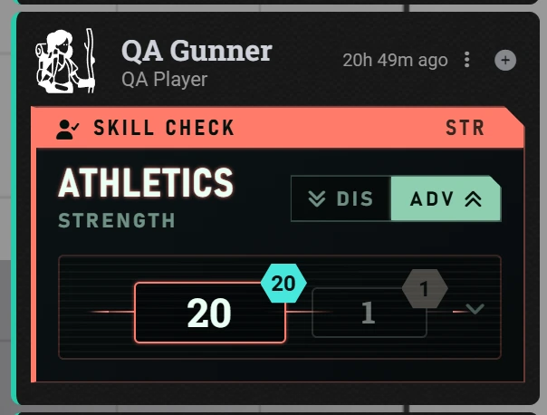</a> <strong>Skill check</strong> Advantage shows the kept and dropped dice.</td>
    <td valign="top"><a href="media/check-ability.webp">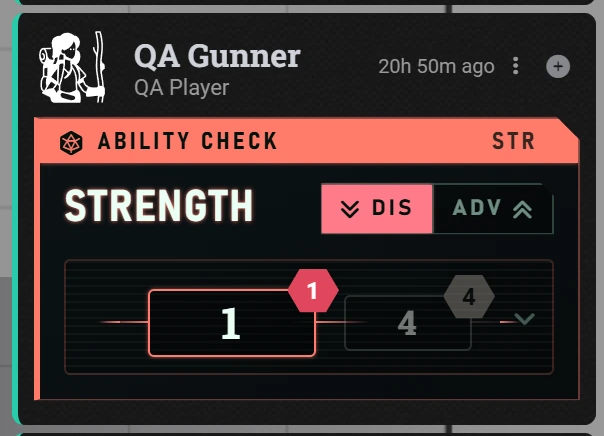</a> <strong>Ability check</strong> Disadvantage retains a visible account of the roll.</td>
    <td valign="top"> <strong>Saving throw (0.7.44)</strong> A dial: the DC at the top, the reading right or left of it, Δ and Saved or Failed in the middle; a bonus shows in violet.</td>
  </tr>
  <tr>
    <td valign="top"> <strong>Initiative</strong> Each roll is one row: the total, your place in the turn order, and who you act after and before. Places update as everyone else rolls; the newest initiative card shows the whole order. Combatants hidden from players stay out of their view.</td>
    <td valign="top"><a href="media/check-concentration.webp">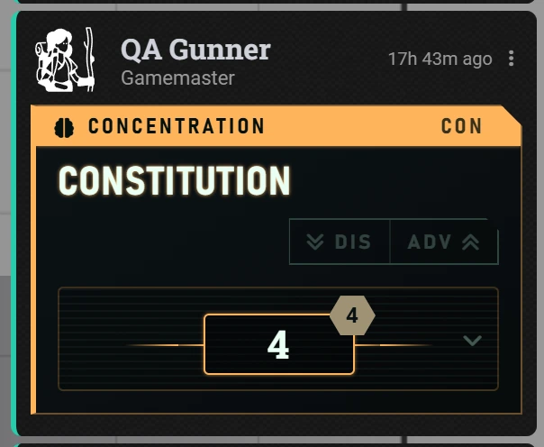</a> <strong>Concentration save</strong> The save card records the concentration outcome.</td>
  </tr>
  <tr>
    <td valign="top"> <strong>Natural 20 (0.7.44)</strong> The needle pegs into the redline and bounces off the limiter.</td>
    <td valign="top"> <strong>Natural 1 (0.7.44)</strong> The gauge cracks, with dead segments and the result knocked out of line.</td>
  </tr>
</table>

## Gear and class features

Use the item or feature through its native activity. The card exposes uses, rolls, saves, or healing appropriate to that activity. [Player actions →](Players.md)

*Native captures: 0.7.38.*

<table>
  <tr>
    <td valign="top"><a href="media/item-potion.webp">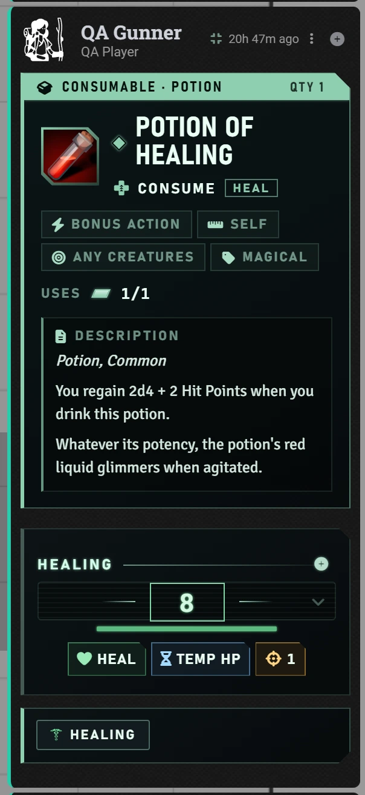</a> <strong>Potion of Healing</strong> The consumable card carries its healing roll.</td>
    <td valign="top"><a href="media/item-alchemist.webp">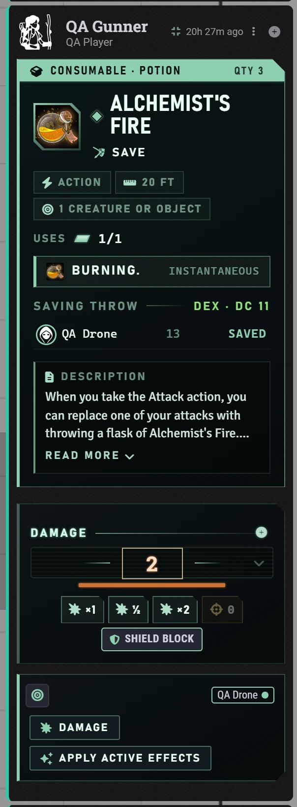</a> <strong>Alchemist’s Fire</strong> A consumable can include damage and a saving-throw table.</td>
    <td valign="top"><a href="media/item-tool.webp">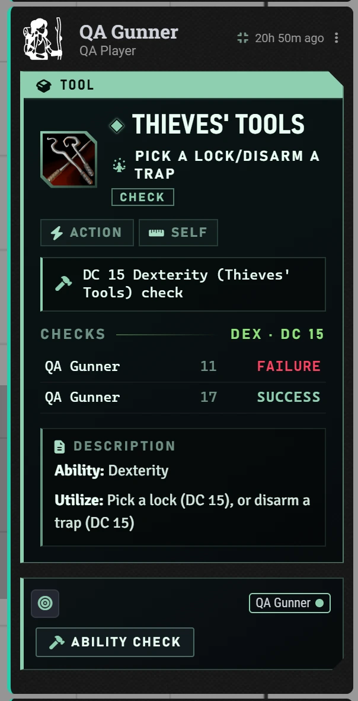</a> <strong>Thieves’ Tools</strong> The tool card collects associated check results.</td>
  </tr>
  <tr>
    <td valign="top"><a href="media/feature-second-wind.webp">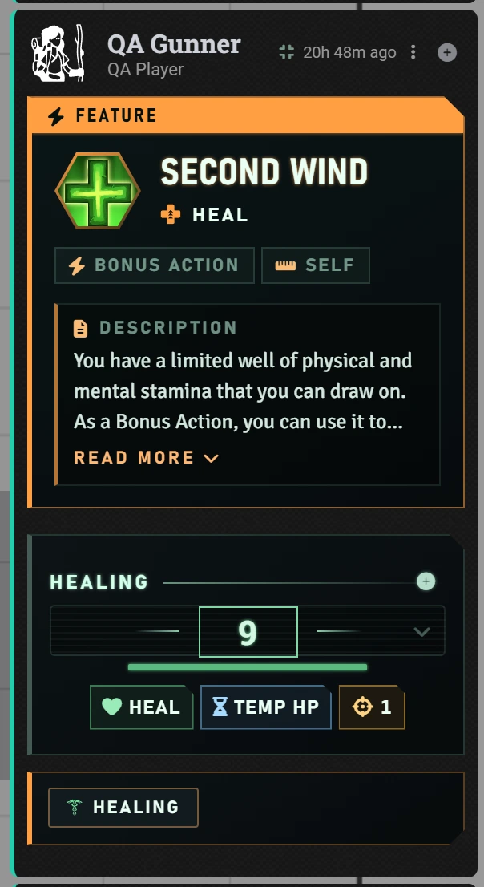</a> <strong>Second Wind</strong> A healing feature shows its result and remaining use information.</td>
    <td valign="top"><a href="media/feature-action-surge.webp">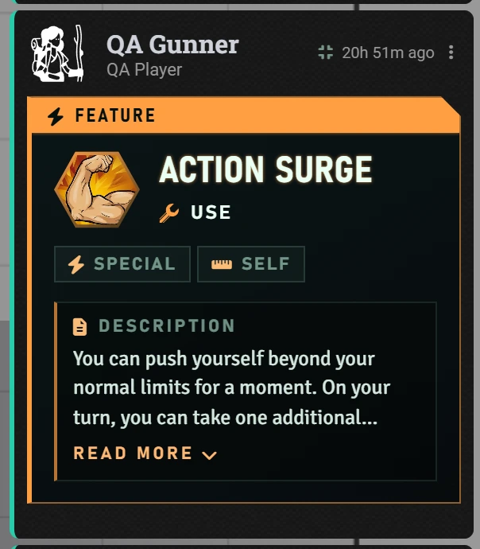</a> <strong>Action Surge</strong> A utility feature presents its use without inventing an attack.</td>
    <td valign="top"><a href="media/feature-poison-breath.webp">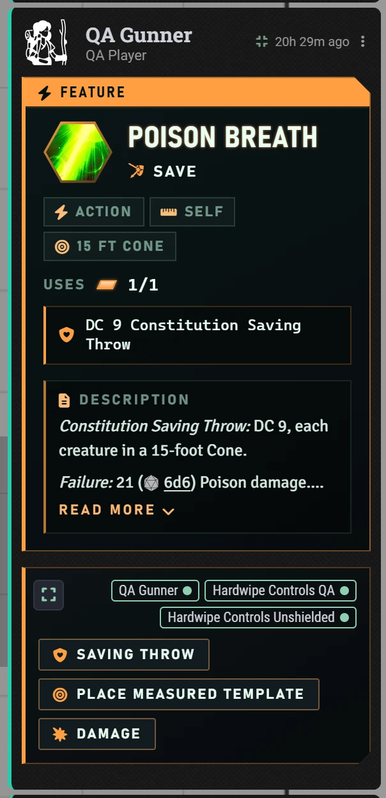</a> <strong>Poison Breath</strong> A feature with saves reports the affected targets.</td>
  </tr>
</table>

## Consumables

One card per use: the item with the doses left, then a scope drawn by what it did, with the result on it. Where there's a roll, the number **is** the roll: click it for the dice. Targets and what happened to them are written out under the scope. **Details** opens the description; the item's own buttons (Refund, Place template) sit beside it. [Effects on the Turn tab →](Players.md#read-your-turn)

<table>
  <tr>
    <td valign="top"><a href="media/consumable-heal.png">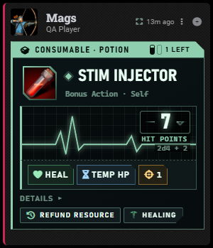</a> <strong>Heal</strong> A vitals trace; the healing roll, Heal and Temp HP.</td>
    <td valign="top"> <strong>Damage and a save</strong> The blast with each target pinned (hover for who), the damage roll with its dice open, each target's save and damage.</td>
    <td valign="top"><a href="media/consumable-buff.png">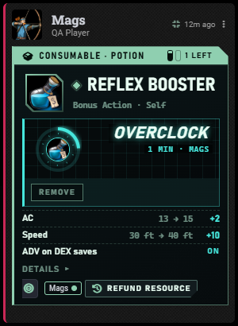</a> <strong>Buff</strong> A ring as long as the effect lasts; what it grants, before → after.</td>
  </tr>
  <tr>
    <td valign="top"><a href="media/consumable-condition.png">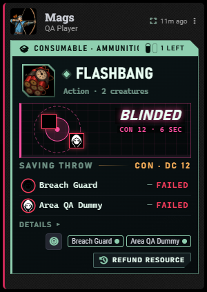</a> <strong>Condition and a save</strong> The blast, the condition and its save; who resisted and who got it.</td>
    <td valign="top"><a href="media/consumable-utility.png">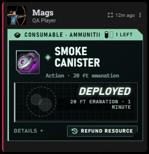</a> <strong>Utility</strong> Nothing to roll or apply: the deployed area and how long it lasts.</td>
  </tr>
</table>

## Class features

Features that heal, buff, force a save or just engage use the same one-card layout as consumables, in the feature's orange, with their uses left and when they come back (**0/1 · SR**) in the bar. Features that attack keep the attack card. **Action Surge** reads **+1 Action · this turn**, and on your own turn in combat the Turn tab gives the action back (with a fresh Attack action).

<table>
  <tr>
    <td valign="top"> <strong>Action Surge</strong> The second action chip lights up; the Turn tab's action is Ready again.</td>
    <td valign="top"><a href="media/feature-second-wind-card.png">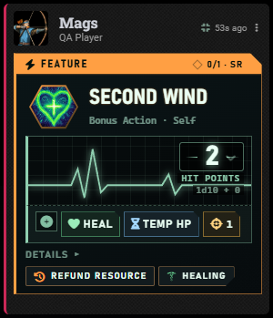</a> <strong>Second Wind</strong> A healing feature reads like a healing consumable, with the roll's +.</td>
  </tr>
</table>

## Tools

Using a tool posts its card with a **Roll check** button (the check is yours to roll; Ready Set Midi's own tool card had no button for it). The result lands on the tool card, in a scope drawn by the kind of tool, and the check's own card folds to a slim row underneath that keeps the roll's **+** and **DIS / ADV**. Click the total for the dice.

- **Most rolls have no DC.** The scope fills by how good the roll is for you (a 1 to a 20 on the die, plus everything added), in cyan, and the stamp names the highest standard DC the total beats, from **Easy · 10** to **Very hard · 25**, for the GM to rule on.
- **With a DC** on the tool's check, it reads **Success** in green or **Failure** in red.
- **Six families**, by the tool's D&D5e type: **Breach** (thieves' tools; cipher columns lock in), **Spoof** (disguise and forgery kits; ID match), **Synth** (alchemist's, herbalism, poisoner's, brewer's, cook's; purity), **Fab** (other artisan's tools; integrity), **Nav** (navigator's and cartographer's tools, vehicles; route lock), **Signal** (instruments and gaming sets; level). Anything else reads as Breach.

## Prompts

Hardwipe's own prompts (the off-turn **Reaction?**, Shield Block, comms, wall types, the Roll Tracker's confirms) and Ready Set Midi's **Apply Retroactive Bonus** share one terminal style: an accent header, a scanlined body, and the default button filled. Cyan asks about your turn, violet adds to a roll, red deletes or ends something.

<a href="media/hardwipe-dialogs.png">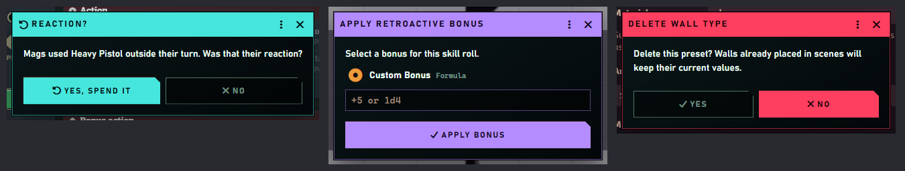</a>

## Crew maneuvers

Firing a crew maneuver posts a CREW card: the crew's camera feeds cut in, two staggered when a crewmate fires someone else's maneuver. A compact Glitch feed is a world setting. [Crew maneuvers →](Players.md#crew-maneuvers)

<table>
  <tr>
    <td valign="top"> <strong>Combo cam</strong> Mags's Entry Stack, round 1.</td>
    <td valign="top"> <strong>A crewmate fires it</strong> Two feeds: Mags fires Juno's Spotter Mark.</td>
    <td valign="top"> <strong>Glitch feed</strong> The same card as a kill-feed line.</td>
  </tr>
</table>

## Cyberware diagnostics

Activated implants use a diagnostic panel with their body region, status, and charges. The underlying item activities still supply attacks, saves, and effects. [Cyberware, inventory, and slots →](Cyberware.md)

*Native captures: 0.7.38.*

<table>
  <tr>
    <td valign="top"><a href="media/implant-optics.webp">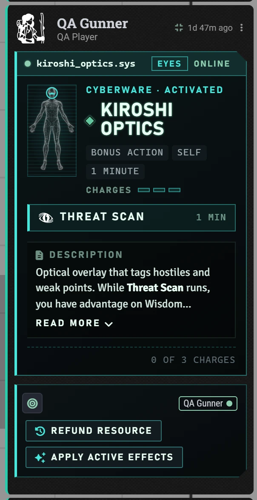</a> <strong>Kiroshi Optics</strong> An activated effect displays the implant region and charges.</td>
    <td valign="top"><a href="media/implant-blades.webp">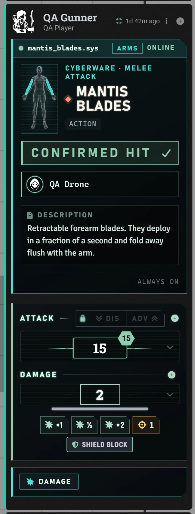</a> <strong>Mantis Blades</strong> An implant melee attack uses the shared attack and damage controls.</td>
  </tr>
  <tr>
    <td valign="top"><a href="media/implant-sonic.webp">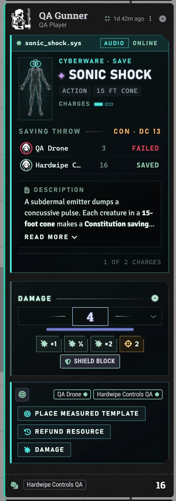</a> <strong>Sonic Shock</strong> A save-based implant displays the target saving throws.</td>
    <td valign="top"><a href="media/implant-neural.webp">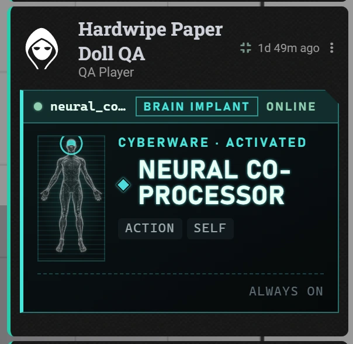</a> <strong>Neural Co-Processor</strong> An always-on implant identifies its passive status.</td>
  </tr>
</table>

## Short-rest monitor

These four captures show the dialog rather than separate chat posts. Roll one Hit Die at a time, inspect the treatment log, and complete the rest when ready. [Rests and recovery →](Rests.md)

*Native captures: 0.7.38.*

<table>
  <tr>
    <td valign="top"><a href="media/rest-8.webp">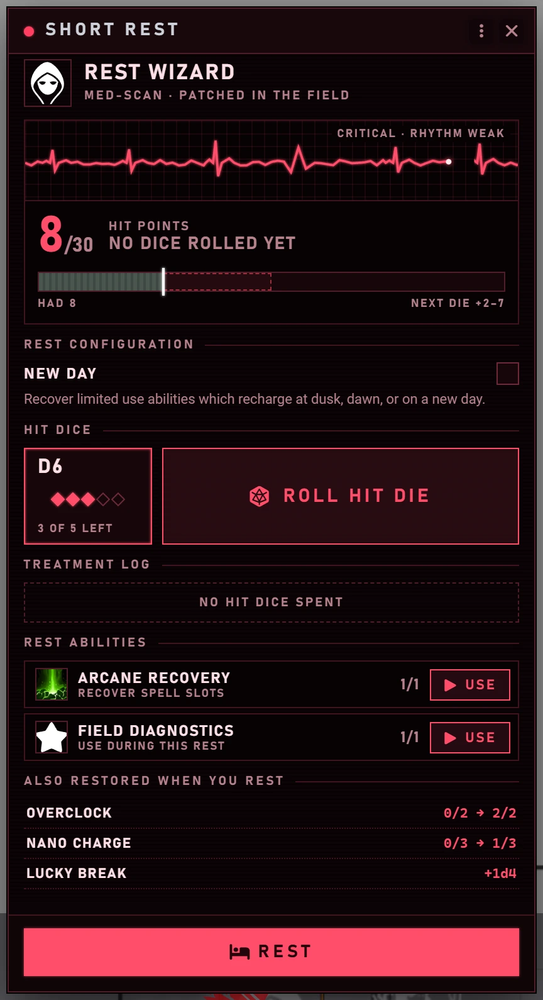</a> <strong>Critical condition</strong> The medical display is red at low HP.</td>
    <td valign="top"><a href="media/rest-15.webp">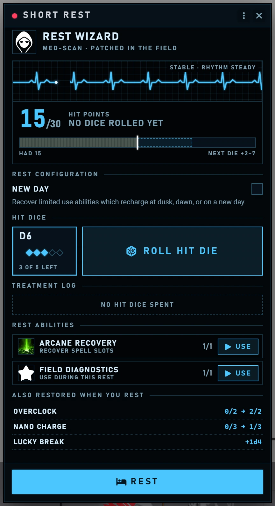</a> <strong>Stabilizing</strong> HP and the treatment log update inside the dialog.</td>
  </tr>
  <tr>
    <td valign="top"><a href="media/rest-25.webp">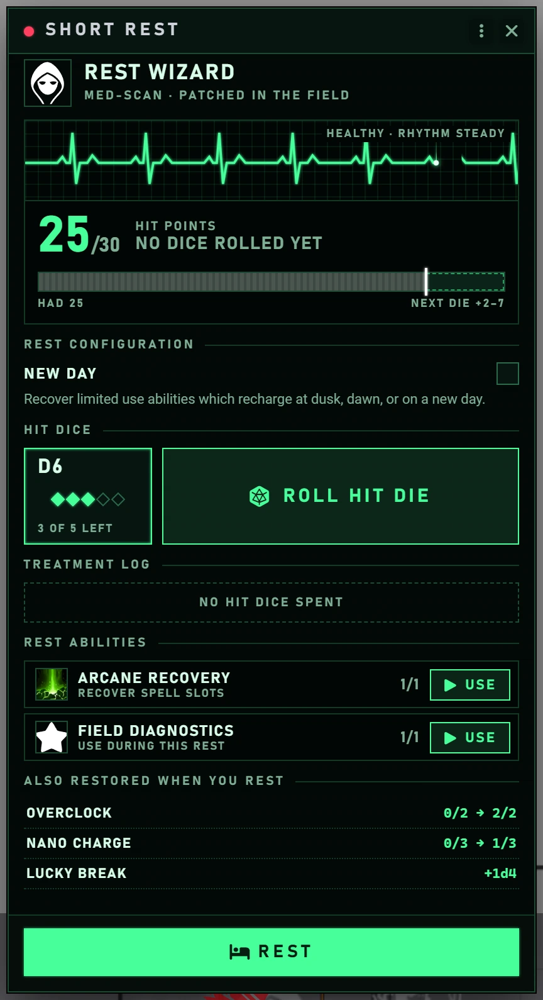</a> <strong>Healthy</strong> The monitor turns green as the character recovers.</td>
    <td valign="top"><a href="media/rest-picker.webp">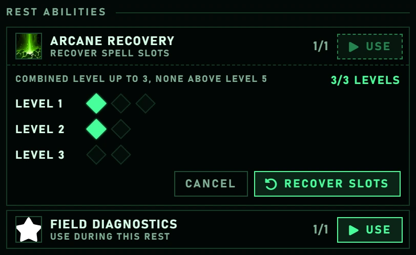</a> <strong>Spell-slot recovery</strong> Eligible recovery abilities open a picker with a level budget.</td>
  </tr>
</table>

Watch the native short-rest monitor in motion · audited preview

Thirty sequential native captures show the running trace and one actual Hit Die expenditure. [Recording provenance](Media.md#fresh-guide-screenshots-and-recording).

## Combined rest receipts

Completing the rest posts one combined receipt. Closing early produces an incomplete receipt while preserving Hit Dice already spent and healing already received. [Read the receipt →](Rests.md#one-final-receipt)

*Native captures: 0.7.38.*

<table>
  <tr>
    <td valign="top"> <strong>Short rest completed</strong> HP, Hit Dice, and recovered resources appear together.</td>
    <td valign="top"><a href="media/receipt-arcane.webp">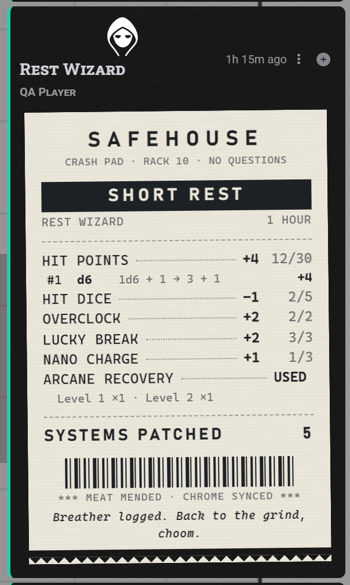</a> <strong>Recovery ability used</strong> The receipt includes recovered spell slots.</td>
  </tr>
  <tr>
    <td valign="top"><a href="media/receipt-long.webp">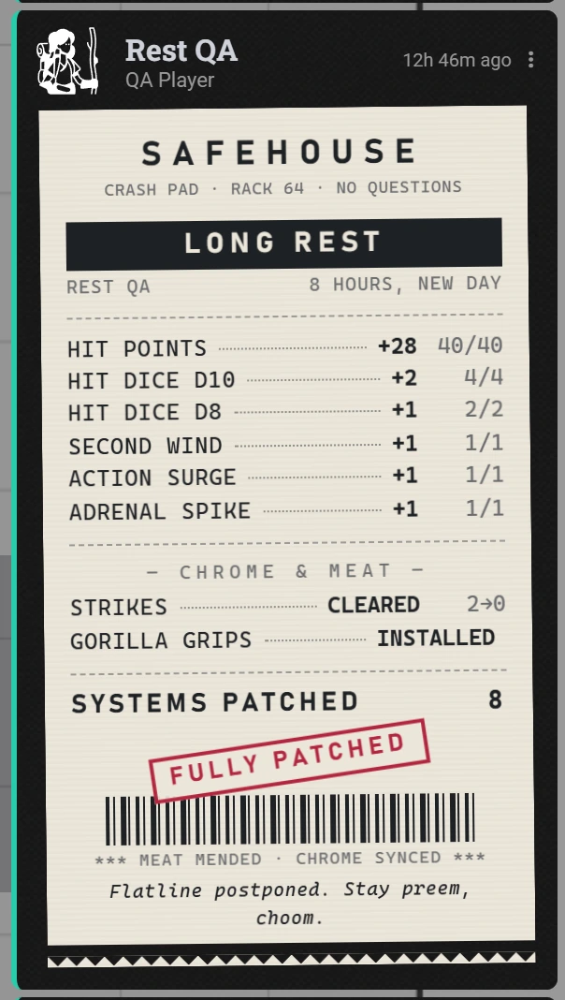</a> <strong>Long rest completed</strong> The thermal slip records the completed long rest.</td>
    <td valign="top"><a href="media/receipt-incomplete.webp">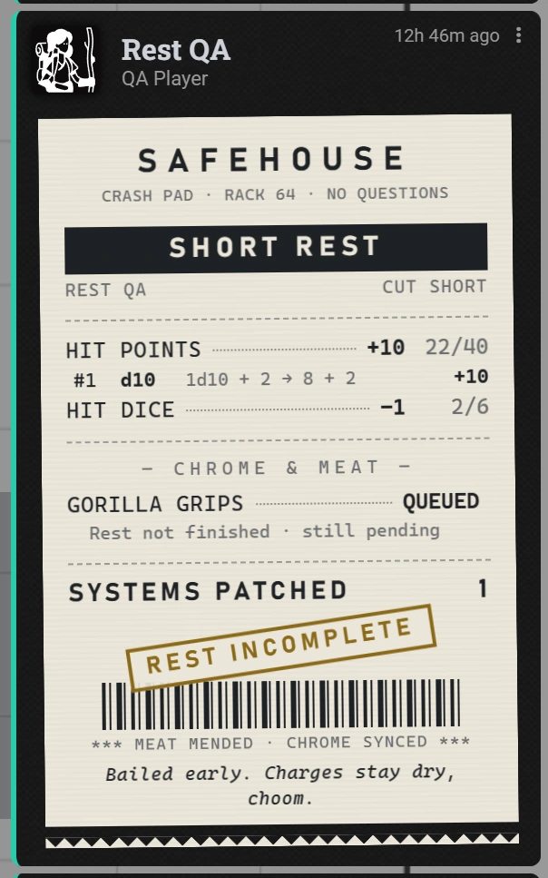</a> <strong>Rest cut short</strong> Already-rolled healing remains recorded without completing resource recovery.</td>
  </tr>
</table>

## Typed messages

*2026-10-18, QA Player's view.* What people type reads as a comm feed: notched portraits and cut-corner bubbles, your own on the right, a name line in the player's colour with the time. **Public** (Foundry's default mode) is the plain bubble, naming the player and the character they play. Marked: **in character** (the mode button or `/ic`) gets a cyan edge and a signal meter (red for anyone who isn't a player character); an **emote** (`/me`) is a status line across the feed; a **whisper** (`/w Name`, `/gm`) is a dashed violet bubble saying to whom; a **text from Smartphone Widget** is a green bubble saying to whom, by phone, in the sender's colour (the module's `[PHONE]` line becomes that tag). Messages in a row from the same voice, within five minutes, join the run above.

*Light mode (2026-10-18).* With Foundry's interface set to light, the feed turns light, with names in a deeper shade of each player's colour. Hardwipe's cards stay dark terminals in both schemes; their contents are pinned to the dark theme so Foundry's light text colours can't reach inside them.

## Plain rolls

<a href="media/roll-formula-current.png">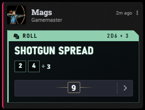</a>

*2026-10-18, a roll typed in chat: `/r 2d6 + 3 # Shotgun spread` (no item; the title is the label after `#`).* A formula roll, a Hit Die, Hit Points or a recharge shows its dice as chips under the title (a die's top face lit, a 1 in red), with the total below; the total still opens the full breakdown.

## Edge, Strikes, and Downed

<table>
  <tr>
    <td valign="top"><a href="media/system-edge-current.png">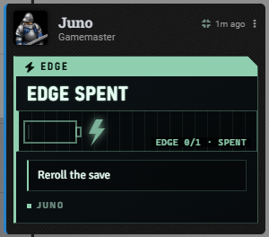</a> <strong>Edge spent (2026-10-18)</strong> Just spend, with no play: the cell drains.</td>
    <td valign="top"><a href="media/system-downed-current.png">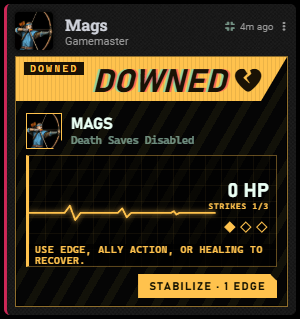</a> <strong>Downed (2026-10-18)</strong> A pulse that falters and which Strike this is; Stabilize for its owner while they hold Edge.</td>
    <td valign="top"><a href="media/system-flatline-current.png">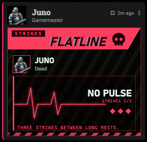</a> <strong>Flatline (2026-10-18)</strong> Two beats, then nothing: Strike 3.</td>
  </tr>
</table>

### Edge plays

*2026-10-18, live in the QA world.* Spend opens the picker; each play posts its own card. Reroll's choice happens on the card whose die it changes.

<table>
  <tr>
    <td valign="top"> <strong>Spend Edge</strong> Four plays; Stabilize greyed (not at 0 HP), Execute waiting on a target.</td>
    <td valign="top"><a href="media/edge-reroll-pick.png">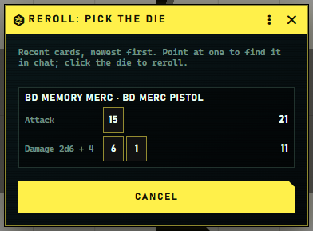</a> <strong>Reroll: pick the die</strong> Recent cards and their dice.</td>
    <td valign="top"> <strong>On the attack</strong> Juno's choice on the Merc's attack card: keep 10 or take 19.</td>
  </tr>
  <tr>
    <td valign="top"> <strong>The GM rules again</strong> A confirmed hit rerolled to 8 vs AC 15.</td>
    <td valign="top"><a href="media/edge-reroll-ruled-miss.png">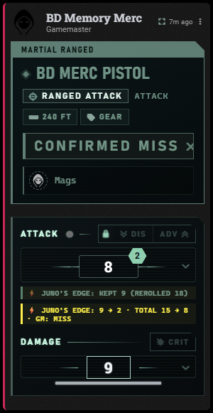</a> <strong>Confirmed miss</strong> The banner flips and Mags's 9 damage comes back.</td>
    <td valign="top"><a href="media/edge-reroll-save-choose.png">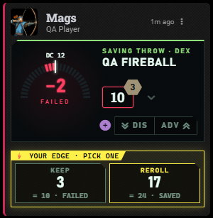</a> <strong>On a save</strong> Mags rerolls her failed DEX save: 3 or 17.</td>
  </tr>
  <tr>
    <td valign="top"><a href="media/edge-reroll-save-spell.png">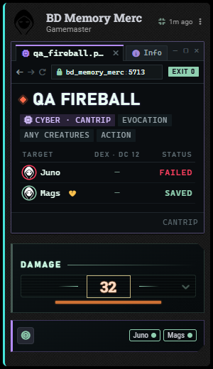</a> <strong>The spell follows</strong> Mags moves to Saved; her damage is redone at half.</td>
    <td valign="top"><a href="media/edge-reroll-damage-choose.png">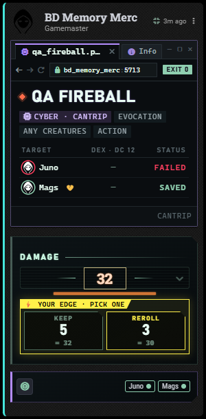</a> <strong>On spell damage</strong> One of the Fireball's 5s: keep it or take a 3.</td>
    <td valign="top"><a href="media/edge-reroll-damage-taken.png">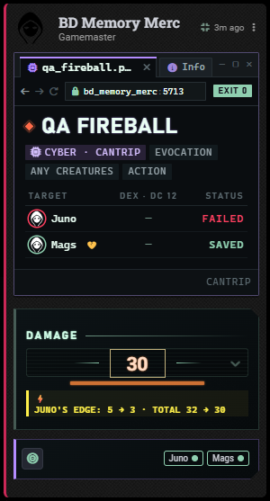</a> <strong>Damage taken</strong> 32 → 30; applied damage adjusted for both targets.</td>
  </tr>
  <tr>
    <td valign="top"><a href="media/edge-interrupt.png">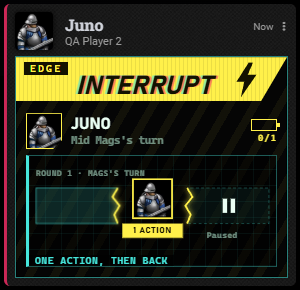</a> <strong>Interrupt</strong> Mags's turn torn open for one action.</td>
    <td valign="top"><a href="media/edge-interrupt-used.png">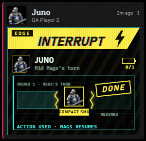</a> <strong>Interrupt used</strong> Juno's SMG shot used it: Done, the turn resumes.</td>
    <td valign="top"><a href="media/edge-interrupt-turn-tab.png">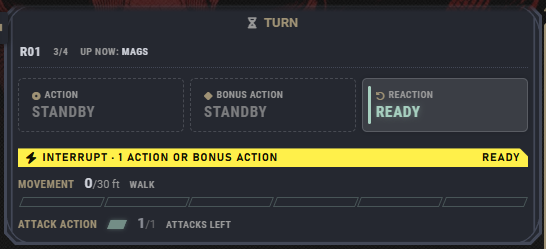</a> <strong>On the Turn tab</strong> Until it's used or the turn moves on.</td>
  </tr>
  <tr>
    <td valign="top"> <strong>Stabilize</strong> 1 HP, Downed cleared, the Strike taken back.</td>
    <td valign="top"> <strong>Execute</strong> The Breach Guard drops, no roll.</td>
    <td valign="top"> <strong>Charged</strong> An award.</td>
  </tr>
</table>

*Native captures: 0.7.39.* Edge announces a reroll expenditure. Downed directs the player toward recovery instead of death saves, and the third Strike announces Flatline. [Edge and Strikes →](Players.md#edge-strikes-and-downed)

## Shield Block

<table>
  <tr>
    <td valign="top"> <strong>Reaction choice · audited preview</strong> Choose Shield Block or Take damage when an equipped shield can absorb the hit.</td>
    <td valign="top"> <strong>Durability HUD · 0.7.40</strong> The result records incoming damage, absorption, damage through, and the broken state.</td>
  </tr>
</table>

[Shield rules and timing →](Combat.md#shield-block-uses-your-reaction)

## Walls and cover review

*Native captures: 0.7.39.* A wall impact reports its rolled damage, armor, and section HP. Destruction announces a five-foot breach; indestructible cover reports that it held. The final example is the private attack review. Wall damage retains its separate GM **Apply damage / Ignore** decision. [Wall types, targeting, and breaches →](Walls.md)

*0.7.46.* An area spell's wall damage waits for the same GM review, section by section.
## Roll calls

<table>
  <tr>
    <td valign="top"> <strong>Ask</strong> The GM's Roll call window (Alt+R).</td>
    <td valign="top"> <strong>The crew rolls as one</strong> Two passes and a fail: the team passes.</td>
    <td valign="top"> <strong>Contests</strong> Two panels against each other, then Apply.</td>
  </tr>
</table>

*Native captures: 0.7.39.* Request a check or save from a party. Owners roll for their characters, and results replace the waiting buttons. The GM view can include information withheld from the player view. [GM roll tools and settings →](GM.md)

Check and save requests are now drawn as a **roll call**, the same card the GM's Roll call window posts: one Roll button for your own characters, then each result with pass or fail when the DC is shown. Contests set two panels against each other. [Roll calls →](GM.md#roll-calls)

## Ordinary formula rolls

*Native captures: 0.7.39.* Plain rolls keep the formula and total. A supplied flavor becomes the readable title. These are ordinary roll cards, separate from attack approval or a short-rest dialog.

## Roll Tracker recap

*0.7.45.* **Post recap** turns a session into a Screamsheet front page in chat. [Roll Tracker →](GM.md#roll-tracker)

## Braindance

<table>
  <tr>
    <td valign="top"> <strong>Every roll is stamped</strong> A check rolled in a memory carries the BD stamp and who really rolled it.</td>
    <td valign="top"> <strong>Clue found</strong> A scan that finds a clue reveals it on the canvas and posts what was learned.</td>
  </tr>
</table>

*0.7.47.* [Braindance →](Braindance.md)

## Mission Heat styles

Pick the mission’s presentation when starting it. Each style covers rising Heat, critical Heat, Lockdown, and a reduction in Heat. These montages show actual card states; they are still screenshots of interfaces that can animate. [Mission Heat →](GM.md#mission-heat)

### Threat broadcast

*Native captures: 0.7.40.* Hazard stripes and a segmented meter announce the changing threat level.

### Corrupted feed

*Native captures: 0.7.40.* A recording feed uses signal bars and percentages to show escalation.

### Police scanner

*Native captures: 0.7.40.* Radar and scanner text frame the security response.

Start a mission and choose the Heat style

*Native capture: 0.7.40.* Set the budget and choose the style before starting the mission.

## Turn-start styles

*Native captures: 0.7.40.* Choose a strip, timeline, or terminal presentation. The turn prompt can expose a qualifying Adrenal Pump **Inject** action. [Turn and interface settings →](GM.md)

## Ranged source advisory

*Native capture: 0.7.43.* The **roll mode scan** sits right under the attack roll. Each source evaluated by Ready Set Midi gets a row: ADV, DIS, or a block (NO ADV / NO DIS), with the source above the rule it comes from; a blocked source is struck through. Beside the title, **Roll** names the mode the sources call for: ADV, DIS, or Straight when advantage and disadvantage cancel. Only sources actually evaluated by Ready Set Midi appear. No evaluated source means no box. The roller or GM chooses the roll mode; the advisory does not change it. [Ranged hints and their limits →](Combat.md#ranged-hints-name-the-actual-source)

## Make the cards readable at your table

The GM can configure card colors, spell color rules, and save-button colors. Players can choose text size and settled-card folding. [Interface configuration →](GM.md) · [Capture versions and processing →](Media.md)
