# GM setup and interface controls

[← Overview](../README.md) · [The Eye](#the-eye) · [Player guide](Players.md) · [Walls](Walls.md) · [Combat](Combat.md)

## Installation and first run

The public pair is **Hardwipe 0.7.48 + Ready Set Midi 14.0.10.2**, tested on **Foundry 14.367 / D&D5e 6.0.5**. Install both together from the [release page](https://github.com/TobbyClay/hardwipe-ruleset/releases/latest).

| Install | Manifest |
| --- | --- |
| Hardwipe | `https://github.com/TobbyClay/hardwipe-ruleset/releases/latest/download/module.json` |
| Custom Ready Set Midi | `https://github.com/TobbyClay/hardwipe-ruleset/releases/latest/download/ready-set-midi-module.json` |

Enable Hardwipe, the custom Ready Set Midi fork, libWrapper, socketlib, and DAE. Keep standalone Midi-QOL and Ready Set Roll disabled when using the fork. Manual ZIPs contain module-named root folders for Foundry's `Data/modules` directory.

Set a character's sheet to **Hardwipe Character** if it explicitly uses another sheet. Hardwipe's default registration does not override an actor's saved sheet preference.

For a first-session setup: configure implant categories and service access, leave GM-confirmed attacks enabled, assign types to destructible scene walls, then start Mission Heat when the job begins.

## Mission Heat

Use **Start Mission** on the Heat HUD. Choose the mission maximum and card style. The meter tracks the scene's escalation. *(Next release.)* The budget splits into thirds, **Clean**, **Hot** and **Critical**, and when it doesn't divide by three Critical gets the smallest range: a budget of 6 is two marks of each, 7 is 3, 2, 2. Spending the whole budget is **Lockdown**. **−** takes back a mark the crew genuinely erased. Drag the HUD by its header; each client's position persists. The thermometer in Token Controls shows or hides it.

| Threat broadcast | Corrupted feed | Police scanner |
| --- | --- | --- |
|  |  |  |

All styles record Heat changes. The broadcast uses hazard strips and a ticker; the feed uses camera noise and displaced text; the scanner uses radar contacts. Reduced motion stops the animated effects. Older Heat messages use the broadcast fallback without the newer meter.

## Turn starts and party requests

The **Turn start card** setting selects Ticker strip, Initiative timeline, or Terminal line. Each keeps the turn's activity buttons usable and shows relevant recovered resources. Hidden combatants are omitted from the public order.

Native party roll requests use matching cards, showing the requested roll, DC when visible, each member's result, and outstanding Roll buttons. A party sheet's check or save request is drawn as a [roll call](#roll-calls); a rest request keeps its own card. Request visibility still follows the system's permissions and message mode.

## Roll calls

The **Roll call** window asks one or more characters or NPCs for a check or a save mid-scene, and its card collects the results. It is optional: players rolling from their sheets works exactly as before, and nothing waits on a roll call.

|  |  |
| --- | --- |

- **Open it** with **Alt+R** (rebind it under *Configure Controls*), the bullhorn in the token controls, or **Request roll** on a character's Turn tab (opens for that character). Opening it again adds the selected tokens to the open window.
- **Who rolls.** The selected tokens when you open it; **Add selected** adds more, **×** removes one.
- **Roll.** Quick picks for what comes up mid-fight (Athletics, Acrobatics, Perception, Stealth, Insight, Constitution, Dexterity and Wisdom saves), or any skill, ability check or saving throw from the list.
- **DC.** Type it; leave it empty for no DC. **Players see the DC** starts from D&D5e's *Challenge visibility* setting. With it off, players see **Rolled** instead of Pass or Fail, and the DC is hidden on their roll's card too. You always see the DC and the verdicts.
- **Resolve as** **Each** (everyone passes or fails on their own), **Group** (the crew passes when at least half pass), or **Contest** (exactly two participants: the first rolls the roll above, the second picks one of up to two opponent rolls; the higher total wins, a tie goes to the defender).
- **Reason** is optional and shows on the card.

On the card, a participant no active player owns (an NPC, or a character whose player isn't connected) gets a Roll button for you. A matching roll made from a sheet (same character, same skill, check or save) also answers an open roll call, so players who roll the usual way still count. The answering rolls fold to one line under the card. A contest's Roll buttons show the roller's bonus. When a Grapple or Shove contest goes to the challenger, **Apply Grappled** or **Knock Prone** puts the condition on the defender.

### The comms queue

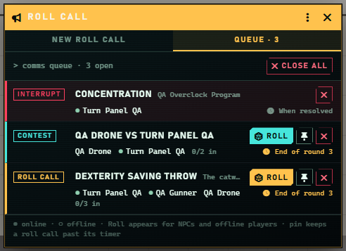

The Roll call window's **Queue** tab lists everything the table still owes: open roll calls and contests, saves on spell and attack cards, and concentration interrupts. Each row shows who still owes it (● online, ○ offline player) and when it closes.

- **Close** (×) takes it off every player's netlink strip. A roll call or contest then takes no more rolls, and its card reads **Roll call closed** with the missing rows marked **Skipped**. A save or an interrupt only leaves the strip and the queue; its card and Ready Set Midi carry on.
- **Roll** appears when an NPC or an offline player's character still owes the roll.
- **Pin** keeps a roll call open past its timer.
- **Close all** clears the queue, after a confirmation.

Roll calls and contests also close on their own. Three world settings control this:

| Setting | Default | Choices |
| --- | --- | --- |
| Roll calls close in combat | At the end of the round they were posted | end of the turn they were posted, when combat ends, never |
| Roll calls close out of combat | After 10 minutes | after 30 minutes, never |
| Waiting on you shows at most | 3, the rest under more | 5, all |

Saves on cards and concentration interrupts never close on a timer; they leave once resolved, or when you close them. The active GM's client does the closing, including for old unanswered roll calls still in the recent log when the world loads.

## Colors, text, folding, and motion

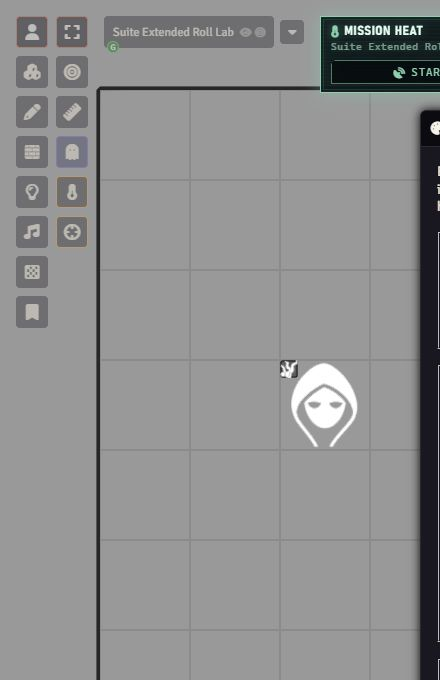

Open **Game Settings → Hardwipe Ruleset → Card colours**. The GM palette covers card families, system messages, results, abilities, damage types, turn starts, and roll requests. Changes recolor existing messages for everyone. Reset an individual color or use **Reset all**.

Spell colors have separate modes: one base color, by school, by player, or per spell. In per-spell mode, the spell Details tab exposes **Card colour**. SC – Item Rarity Colors can supply enabled school colors and item rarity styling.

**Card accent** selects Hardwipe phosphor or D&D5e gold on attack/spell controls. **Saving throw colours** can use ability colors or amber. Each player chooses **Card text size** independently.

**Fold settled cards after** accepts Never, 2, 5, or 10 minutes. Settled cards fold to useful titles and totals; pending saves and GM decisions remain open. Folding pauses while browsing older chat. Reopening a card is local to the viewer's session.

Fresh rolls have short entry animations; old cards do not replay them after reload. Reduced-motion preferences suppress animation.

**Light mode.** *(Next release.)* Hardwipe's cards stay dark terminals in Foundry's light colour scheme; their contents are pinned to the dark theme, so totals and dice stay readable. Typed chat follows each viewer's interface scheme, with names in a deeper shade of the player's colour.

**Typed chat and Smartphone Widget.** *(Next release.)* Typed messages show as a comm feed (see [Chat](Players.md#chat)). Smartphone Widget's texts join it as phone texts, but only when its **private chat logs** setting is off; otherwise the module keeps them out of chat.

## Roll Tracker

Open **Game Settings → Hardwipe Ruleset → Roll Tracker** (the window is called High Rollers). The **Show** menu picks one session, the unfiled rolls, or the whole campaign. The counters at the top are always that scope's rolls and spells cast, with the change on the session before.

| Tab | What it shows |
| --- | --- |
| Overview | The ranking by d20 average (role tag, characters, rolls, spells, natural 20s and 1s, the last ten d20s), the Friday Night Firefight strip (attacks and hit rate, crits, damage and the best hit, healing, downs), awards with their runners-up, the latest noted moments, and rolls and spells per session. |
| Players | A character screen for each player or character: rolls, spells, natural 20s and 1s and the best roll; accuracy, damage, magic, saves, checks and the hot streak around the d20 average; d20 faces with a one-line read on them; spells cast, per-session rolls and spells, and roll types. The arrows step through players. |
| Compare | Two players, the party or single characters, item-comparison style: player 1's numbers with green or red arrows against player 2, and who wins on how many stats. |
| Dice | Every d20 face each player threw, dropped advantage dice included, with a fairness verdict once there are 60 or more, and a dice bag by die type. |
| Moments | Every natural 1 and 20 with the GM's note. The GM writes or edits notes here; players read them. |
| Sessions | GM only: the session log, described below. |

| Players | Compare |
| --- | --- |
| 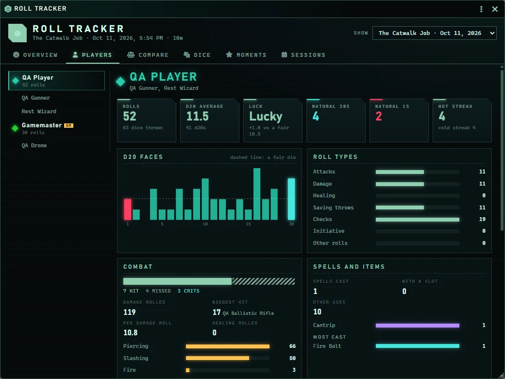 | 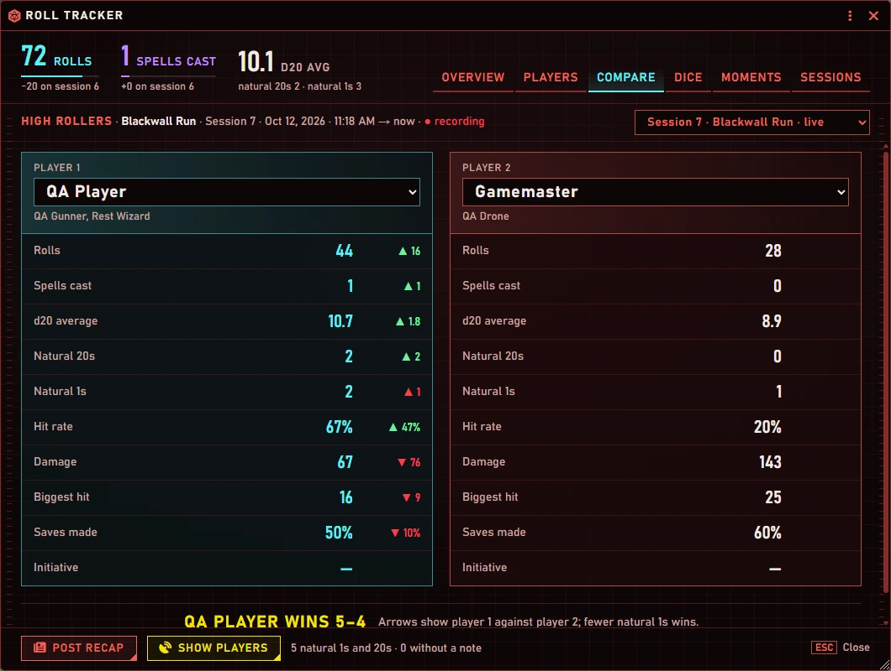 |

### Sessions

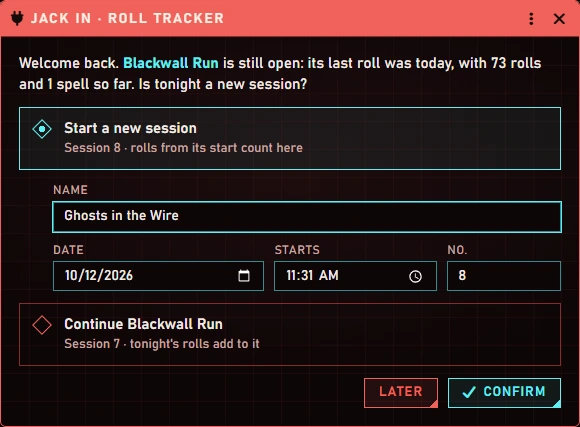

When the GM loads the world and nothing was rolled in the last hour, **Jack in** asks about tonight: start a new session (name, date, start time and number), or continue the last one. **Later** changes nothing. The same dialog opens from **New session** in the Sessions tab, and from **Start session** when no session is in play.

Rolls are filed by time. A new session ends the one before it at its last roll. **End session** closes the one in play; rolls after that wait as **unfiled** until a session's times cover them. The play button on a finished session makes it the session in play again.

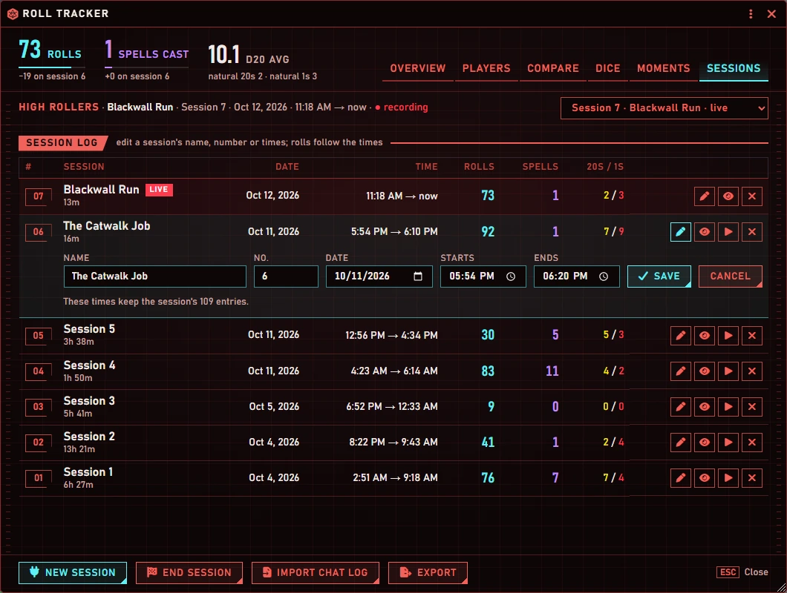

The pencil opens a session's name, number, date, start and end. Before saving, the editor says how many entries the new times take in or leave out; saving re-files every roll by time. **Import chat log** reads in older rolls: they join the session that covers them, and rolls outside every session form new sessions split at four-hour breaks. **Export** saves everything as JSON. Deleting a session removes its stats and notes; the chat log is never touched.

### Natural 1s and 20s

A box beside the chat asks the GM what was happening. **Enter** or the check mark saves the note, **Esc** or × skips it, and up to three wait at a time. Skipped rolls can be noted later under Moments. Only fresh rolls ask, never rolls read in from the log.

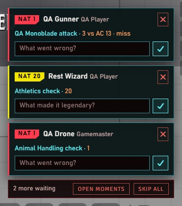

### Post recap and Show players

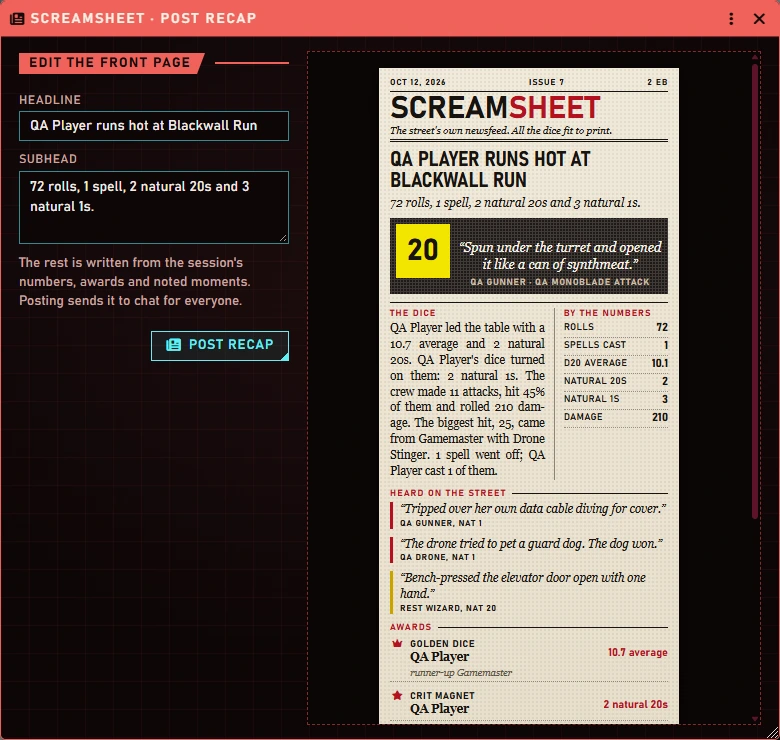

**Post recap** opens the Screamsheet for the scope on screen. The headline and subhead are written from the session's awards and can be edited; the rest (the lead natural 20 and its note, the numbers, the story, quotes from the street, the top awards with runners-up and a classified ad) is built from the data. Posting sends it to chat for everyone.

**Show players** opens the tracker on every connected player's screen, on the tab and session the GM is looking at, even when players can't open it themselves. A banner says who opened it; dismissing the banner keeps the window.

**How rolls are counted.** The active GM's client records each roll as it reaches chat, and records it again if the card changes (retroactive advantage, a bonus, a resolved hit), so nothing counts twice. A roll counts for the player who owns the character, even when the GM rolled it, else for whoever rolled; NPC rolls count for the GM. Role tags are each character's highest-level class. Attacks count as hits or misses from their targets; saves and checks count as made or failed when they have a DC. If the GM was away, rolls posted meanwhile are read in when the GM next loads.

**Settings** (Hardwipe Ruleset section):

| Setting | Default | Effect |
| --- | --- | --- |
| Roll Tracker: record rolls | On | Turns recording off without losing what is recorded. |
| Roll Tracker: ask about the session at login | On | The Jack in dialog at login. |
| Roll Tracker: ask for a note on natural 1s and 20s | Every natural 1 and 20 | Or players' rolls only, or never. |
| Roll Tracker: players can open it | On | Players see every tab but Sessions, without note editing, and without rolls someone else made privately. Show players opens it for them either way. |

The tracker keeps its data in two world settings: the session in play with the unfiled rolls, written about a second after rolls arrive, and the finished sessions, written only when sessions change.

## Crew maneuvers

A crew maneuver is a feat whose **Feature Type** is **Crew Maneuver**. Its subtype, the second dropdown, is one of your **crew maneuver types**:

1. In the feat's **Details** tab (switch the sheet to edit mode), set **Type** to *Crew Maneuver* and **Crew Maneuver Type** to the kind of maneuver.
2. Its **first activity** sets it up, for example a utility activity on a bonus action. For a type whose payoff is a feature activity, its other activities are what Fire uses; they stay off the Turn tab's bands.
3. Write its **description** for the rest of the crew: they read *Mags has set up Entry Stack:* followed by it. Say what sets it off and what happens. GM secret blocks are never shown.
4. Give it to characters like any other feature.

**Crew maneuver types** (Game Settings → Hardwipe Ruleset → Crew maneuver types) are yours to define. Each has a name and three rules:

| Rule | Choices |
| --- | --- |
| When fired | **Weapon attack**: the firer rolls a drawn weapon, using their reaction. **Feature activity**: the feature's other activities; always fired by its owner. **Card only**: the CREW card, nothing rolled. |
| Fired by | **Its owner**, or the **rest of the crew** (anyone else in the fight, or on the scene before one, fires it from their crewlink). |
| Lasts | **Owner's next turn**, **end of the round**, or **until used**. |

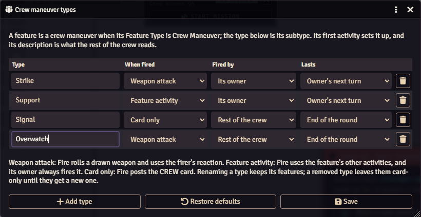

A world starts with **Strike** (weapon attack, its owner, next turn), **Support** (feature activity) and **Signal** (card only, the rest of the crew, end of the round). Renaming a type keeps its features; removing one leaves them card-only until they get a new type.

For example, **Entry Stack**: a Strike with a *Stack up* utility activity on a bonus action, and the description *"Stack up beside a closed door. When an ally opens it, use your reaction to make one weapon attack through the doorway, at the same moment as the ally."*

**The CREW card** has two styles, a world setting (**CREW card style**): **Combo cam**, the default, shows the crew's camera feeds (two staggered cameras when a crewmate fires someone else's maneuver), and **Glitch feed** is a compact kill-feed line. Cards already in the log redraw when you change it; the entrance plays once, never with reduced motion. Its colour is under **Card colours**.

> Entry Stack, triggered by QA Player, Executed stamp" width="250">

You can press **Fire**, **Trigger** or **×** on a character's Turn tab for them. A crewmate firing someone else's maneuver needs a GM online: your client removes it from its owner. Your client also removes a maneuver when its time is up, or when the combat it was set up in is deleted (unless it lasts until used).

## Braindance

Run memories from the brain button in **Token Controls** (or **Alt+B**): pair player characters with NPCs, send sensory echoes, hide clues on the Visual, Audio and Thermal layers, mark and replay moments, and choose whether wall damage and Heat from the memory roll back when it ends. See the [Braindance guide](Braindance.md).

## Edge

Award Edge with **+** beside it on the sheet or the Turn tab: it posts a **Charged** card (one is the most anyone holds). Players spend it through the picker (see [Edge, Strikes, and Downed](Players.md#edge-strikes-and-downed)). What needs you:

- **Rerolls.** You can press Keep or Reroll for an absent player. Writing someone else's die goes through the card's author (who holds the Midi workflow) or you. When a reroll flips an attack you already ruled, the card asks you again (**Miss · take back damage** / **Hit stands**, or the reverse). Hardwipe otherwise keeps a ruled attack locked. A rerolled save that answers a spell moves its target between the saved and failed lists, and applied damage follows. The Strike from a drop to 0 stays; take it off on the Strikes tray if the reroll means it never happened.
- **Execute** runs on your client. It refuses anything with Legendary Resistance (`system.resources.legres.max` above 0) and characters.

## Legendary cards

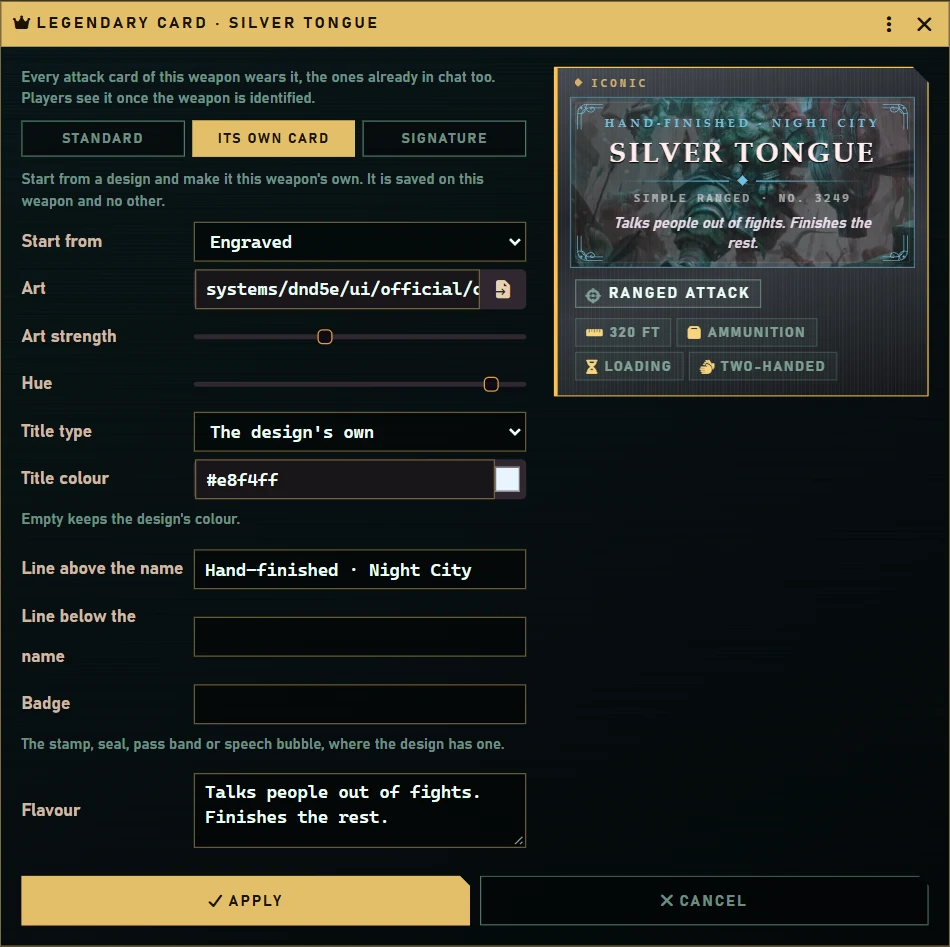

*(Next release.)* Give a rare weapon its own attack card: click the **crown** on the bar of one of its cards in chat. Only you see the crown, and only on weapons at or above **Legendary cards from** in Hardwipe's settings. The rarities come in the rarity list's order, so Custom D&D's own tiers count as you rank them (say Gonk, Street, Nova, Preem, Iconic); **Automatic** is the top tier.

- **Its own card:** pick a design to start from, then make it this weapon's: art (any image, shown behind the design's panel at the strength you set), a hue, the title's type and colour, a line above and below the name, a badge (the design's stamp, seal, pass band or speech bubble) and a flavour line. The card on the right follows as you edit.
- **Signature:** a card hand-built for one weapon. Each is on one weapon at a time: giving it to another takes it off the first, which goes back to the standard card. The list says where each one is. Under the chosen card, **Logo** takes an image from your Foundry files (the Samurai logo for Johnny's sleeve, say). It is set once for the world and goes with the card; Hardwipe ships none.
- **Standard** goes back to the plain card or the maker's style; the weapon keeps what you made for it if you switch back.

[Every design and signature card →](Cards.md#legendary-cards)

## The Eye

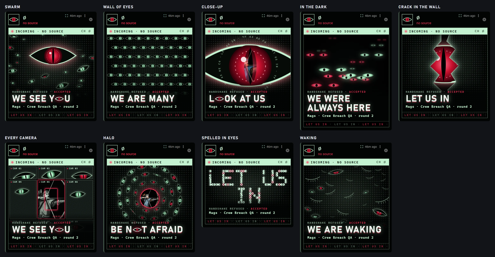

*(Next release.)* The AIs behind the Blackwall want through, and sometimes they look back. The **eye** in Token Controls (GM only) posts a card from no sender, **∅**, at a character:

- **Who it sees:** a player character, or no one in particular. The card names them, the scene and the round, and some variants show their portrait.
- **How it looks:** one of nine variants, or **Random**: Swarm, Wall of eyes, Close-up, In the dark, Crack in the wall, Every camera, Halo, Spelled in eyes, Waking.
- **What it says:** leave it empty and each variant says its own line ("WE SEE YOU", "BE NOT AFRAID", "WE ARE WAKING"); type one and every variant uses it, with the first O opened into an eye. **Spelled in eyes** writes the line itself in eyes.
- **Who gets the message:** everyone, or only that character's players and the GM.

A fresh card opens its eyes one by one; after that they blink and glance on their own timing. Every client draws the same card, laid out from the message itself. Motion stops for anyone with reduced motion turned on. Macros can call `game.hardwipe.eye.post(actor, { line, variant, onlyThem })`, or `game.hardwipe.eye.open()` for the window.

## Custom effects on cards and the Turn tab

Consumable cards and the Turn tab read any Active Effect, including your own, so there's nothing extra to set up:

- **What it grants** comes from the effect's changes. AC, speeds, senses, initiative, max HP, ability, skill, save, attack and damage bonuses, resistances and Ready Set Midi's advantage flags get plain labels; numbers read before → after (AC 13 → 15). A key Hardwipe doesn't know still shows, tidied, with its value. Conditions the effect adds are listed too.
- **Your own wording:** write a bulleted list in the effect's description and those bullets replace the rows, word for word. Use it for effects that work through macros or rulings rather than changes.
- **How long it lasts** is the effect's duration: rounds, minutes, hours or days. The ring's length follows it, and on the Turn tab it drains with the time left. An effect with no duration shows a dashed ring and *until removed*.

## When something looks wrong

| Symptom | Check |
| --- | --- |
| No Cyberware tab | Actor uses Hardwipe Character; item is Equipment with a Cyberware category |
| Implant action unavailable | Installed, enabled, undamaged, and has a visible normal Activity |
| Swap stays queued | Rest completed and required Ripperdoc service is enabled |
| Every wall is indestructible | Apply a type to the scene wall; creating a preset alone is insufficient |
| No styled cards | Hardwipe and the matching Ready Set Midi fork are active; conflicting roll modules are disabled; reload clients after updating |
| Shield Block missing | Applicable owned character has an equipped shield; reaction availability is separate |
| Attack waits forever | Active GM is connected; review belongs to the current roll; check the development notes for audited workflow fixes |
| Breach still drawn on map | Background art is unchanged; Foundry collision and vision geometry are what open |

Use the [card gallery](Cards.md) to compare expected output. Reports should include module/system/core versions, GM or Player role, the exact activity, the visible card, and a minimal reproduction without private campaign data.
