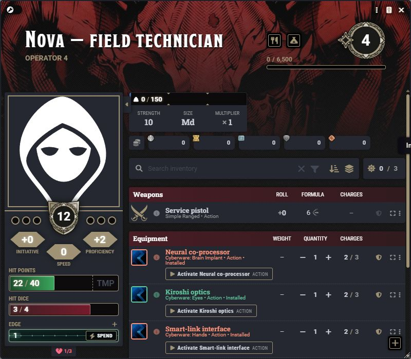
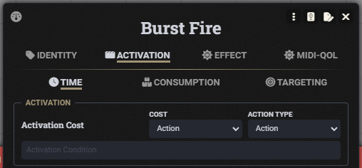
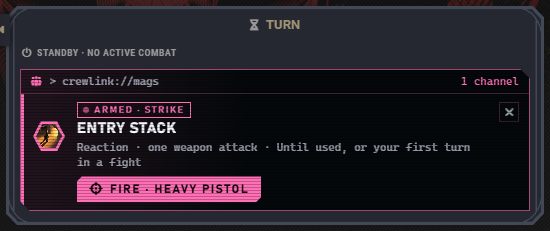
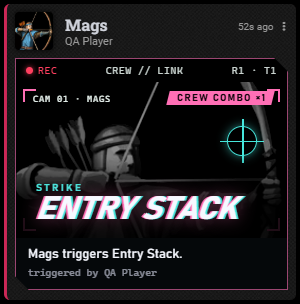
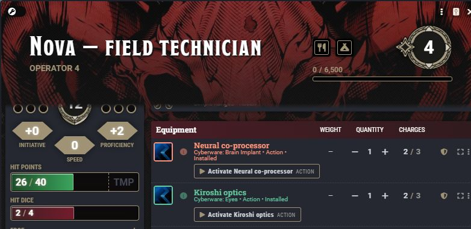
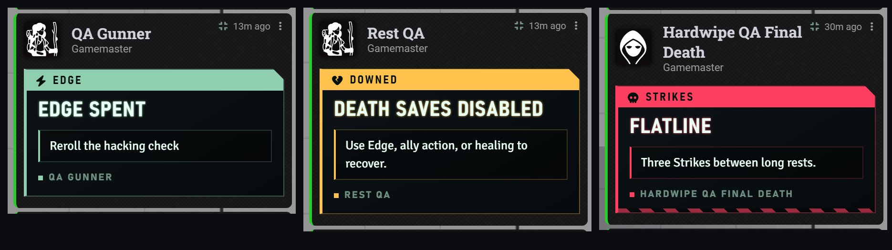
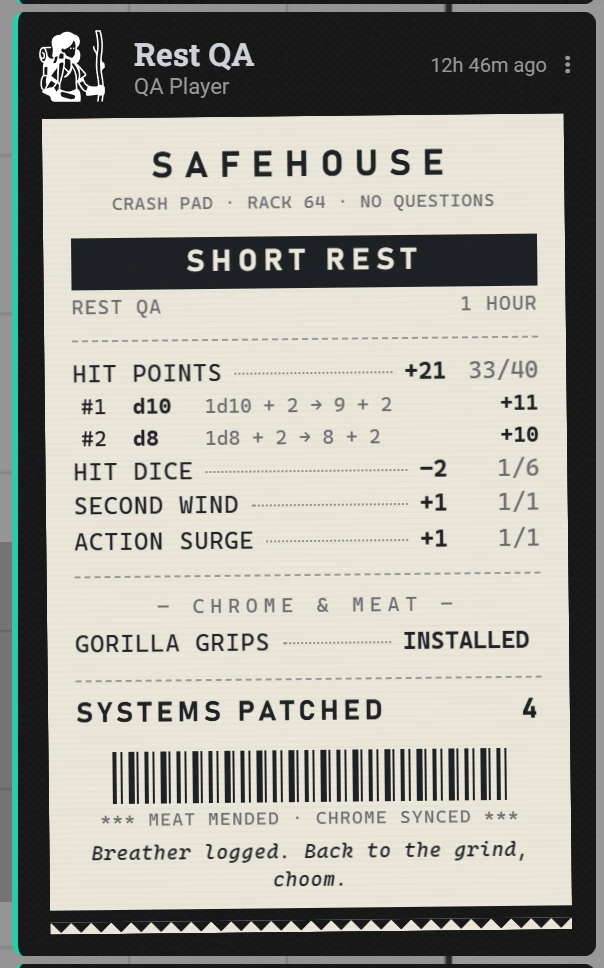

# Player guide

[← Overview](../README.md) · [Cyberware](Cyberware.md) · [Rests](Rests.md) · [Combat](Combat.md) · [Card gallery](Cards.md)

## Start on the character sheet

Use **Hardwipe Character** as your character's sheet. Inventory, activities, effects, spells, and the ordinary D&D5e controls remain available. The chip tab opens your cyberware and the hourglass tab your [turn](#read-your-turn); the sidebar holds Edge and the Strikes tray.

The example shows online implants, a disabled spine implant, and damaged dermal equipment. State labels carry the meaning even when rarity colors change the frame.

## Use an action

An implant with an activity has a named action button on its **same inventory item**. Use it there or from Cyberware's detail panel. Activation cost and remaining charges are visible. Carried, disabled, and damaged implants cannot activate. Passive-only implants do not acquire an extra action.

Use weapons, spells, tools, and features through their normal activities. Their cards keep the relevant controls; selecting a roll total opens the dice breakdown.

## Read your turn

The hourglass tab is your **Turn** helper: where your turn stands, and what you can still do with it.

- **Action, Bonus action, Reaction.** Three chips at the top read **Ready** or **Spent**. On someone else's turn your action and bonus action read **Standby**, but your reaction stays live. While you're working through the Attack action, the action reads **Attacking · 1 left**. Click a chip to correct it, for example after a Help that had nothing to click.
- **Movement.** The distance you've moved this turn, read from your token's path, against your speed for the way you're moving. Difficult terrain counts what it costs. The cells turn amber at your limit and red past it.
- **Attack action.** How many attacks you have left out of what one Attack action gives you (**2/2**, **1/2**, **0/2**), with the feature that grants them (Extra Attack, Two Extra Attacks, Thirsting Blade). What counts is each activity's [Action type](#attack-action-or-action).
- **What you can use.** Below, one band per cost lists what you can spend it on: weapons in hand first, then implants, features and programs (with your spell slots beside them), each with to-hit or DC, damage and range. Click one to use it; hover its image for the full item. Consumables and tools fold away under **Gear**, and anything slower than a turn under **Outside combat**.
- **What's greyed and why.** A spent band greys its options (mid-attack, only what's left of the Attack action stays lit); using one anyway only warns you, since Action Surge exists. An option also says why it may not work now: **Not drawn**, **No uses left**, **No slots left**, an implant that's **Offline** or **Damaged**.
- **Opportunity attacks.** Your equipped melee weapons also sit in the Reaction band, with their first attack that is an Attack action. On someone else's turn, attacking with one from there spends your reaction.
- **Standard actions.** At the foot of the Action band, one row each for Dash, Disengage, Dodge, Hide, Grapple and Shove, with what it does and what it would cost right now. Dash, Disengage and Hide fall back to your bonus action once the action is gone, as Cunning Action allows. Dash doubles your movement, Dodge puts **Dodging** on you until your next turn, and Hide rolls Stealth. Grapple and Shove take one attack of your Attack action and roll Athletics; with exactly one creature targeted they post a [contest](#roll-calls-and-contests) instead. Click a taken row again to take it back. Help, Ready, Search and the like have nothing to track, so just tell the table.
- **Netlink.** The terminal strip above the chips lists the rolls the table is waiting on you for, each with a solid **Roll** button, so you don't have to dig through chat. Red is a save you owe right now (**Interrupt** for concentration, **Save** for a spell's save), amber a GM's **Roll call**, cyan a **Contest**. It says **DC 12**, or **DC hidden** when the GM keeps it to themselves. Saves you owe now come first; past the GM's limit the rest fold under **Show all**. After you roll, the strip shows **Sent to the GM** with your total for a few seconds. With nothing pending there is no strip.
- **Running programs and conditions.** What you're concentrating on, with **End program**, and every condition on you with **×** to clear it. Exhaustion comes off one level at a time; a condition that comes from an item, such as an implant, isn't cleared here.
- **Edge & Strikes.** The same Edge and Strikes as the sidebar, with **Spend**, and **Recover · 1 Edge** while you're Downed.

Everything resets when your turn starts; your reaction comes back then too. When Ready Set Midi counts reactions (its **Enforce Reactions** setting is anything but *Do not check*) or bonus actions (**Enforce Bonus Actions** prompts for characters or all actors), the chips follow Midi's markers, so they always match the icon on your token. Shield Block reads the same Reaction chip.

### Attack action or Action

Anything that costs an action either is one attack of the Attack action, or takes the whole action. An activity with an Action cost has an **Action type** beside its **Cost**, on the activity's **Activation** tab:

- **Attack action:** one attack. Extra Attack gives you more in the same action, Grapple and Shove can take the others, and it can be an opportunity attack.
- **Action:** the whole action, like a burst of fire or a spell. Using it spends the action, and no attacks are left.

Until someone picks, weapon and unarmed attacks are **Attack action** and everything else, spell attacks included, is **Action**. The Cost stays D&D5e's own **Action**, so Ready Set Midi and other modules still see an action.

### Roll calls and contests

The GM can post a **roll call**: a check or a save for one or more of you, with or without a DC on show. It's a convenience, not a gate. When the GM just says "roll Perception", roll from your sheet as usual; a roll call only keeps everyone's results in one place.

- Press **Roll** on the card or on the netlink strip, or roll it from your sheet as usual: while a roll call waits on you for that skill, check or save, a matching roll from the sheet counts as your answer. The normal roll dialog opens, so advantage, bonuses and Edge work as usual. Your roll's own card folds to one dashed line under the roll call (**Answered on the roll call**); click it to open it again.
- The card marks each of you **Waiting**, then **Pass** or **Fail** with the margin when the DC is shown, or **Rolled** when the GM keeps it hidden. A group check also says whether the crew passes: at least half of you must.
- The GM can close a roll call, and it also closes on its own (by default at the end of the combat round it was posted in). It then leaves your strip, the card reads **Roll call closed**, and anyone who hadn't rolled shows **Skipped**.

- **Contests.** Grapple or Shove from the Turn tab with one creature targeted posts a contest card: your Athletics against its Athletics or Acrobatics (whoever controls it picks). When you defend, each button shows your bonus (**Athletics +5**, **Acrobatics +2**). The higher total wins and a tie goes to the defender; the card shows both totals and the margin, and the GM applies **Grappled** or **Prone** from it. With no target, or several, it's a plain Athletics roll.

## Crew maneuvers

A crew maneuver is a feature one character sets up and the rest of the crew pays off. What it does is written in the feature's description; its type (Strike, Overwatch and so on) decides who fires it and how long it lasts.

| Your armed maneuver | A crewmate's, that you fire |
| --- | --- |
|  |  |

1. Use it from your Turn tab, where it's tagged **Crew**. It's now **armed**: your token shows its icon, and your Turn tab's **crewlink** panel lists it with how long it lasts.
2. The rest of the crew sees *Mags has set up Entry Stack:* and the feature's description in their own crewlink.
3. When the moment comes, whoever fires it presses the button:
   - a **Fire · weapon** button rolls that weapon and uses the firer's reaction (if that's already spent, Fire only warns);
   - a **Fire · activity** button uses the feature's own activity;
   - **Trigger** just posts the card.

   Some types are fired by the character who set them up; others by anyone else in the crew, from their crewmate's row.
4. **×** stands down without using it.

Nothing watches the table: the crew says when it happens, and the firer presses the button. The CREW card goes to chat, and an attack goes to the GM's review like any other.

| Combo cam (the usual card) | When a crewmate fires it |
| --- | --- |
|  |  |

The GM can switch the card to the compact **Glitch feed** instead.

## Edge, Strikes, and Downed

**Edge** is a single stored resource. The sidebar shows whether you have it and provides **Spend**. The GM's award control restores it. A living Downed character can use the labeled Edge recovery action when eligible.

**Strikes** replaces the character death-save tracker. Open its tray to see the three cells and your status. At zero HP, a character becomes Downed under Hardwipe's rules; three Strikes means Dead. A qualifying long rest clears living characters' Strikes and Downed. An ordinary rest or Edge recovery cannot revive someone on three Strikes. NPC zero-HP handling stays separate.

The module blocks ordinary character death-save rolls and explains the replacement in chat. Healing and ally assistance remain available through the game's normal actions and the GM's adjudication.

## Attack and react

1. Target the creature and use your weapon or attack activity.
2. Choose normal, advantage, or disadvantage as appropriate.
3. Inspect the roll while the GM confirms the outcome.
4. Resolve eligible saves and reactions when prompted.

GM review and wall review are separate decisions. A shot that strikes cover never silently damages the wall. [Combat](Combat.md) explains the cards and [Walls](Walls.md#target-a-wall-directly) explains direct wall targeting.

## Rest and recover

Open **Short Rest**, roll Hit Dice one at a time, and finish when ready. The chat receives one receipt instead of one message per die. Closing early keeps healing already rolled but does not complete resource recovery or implant swaps. [See the full rest flow](Rests.md).

## Inside a braindance

When the GM puts you in a memory, your NPC sheet opens and your token changes; play it like your own. The bar at the top right switches editing layers (**Alt+L**) and **Scan** (**Alt+S**) reads a spot on the canvas for clues. Traces only show on their layer. Your comfort controls are under the brain button; **Alt+Shift+B** hides the visuals on your screen. See the [Braindance guide](Braindance.md).

## Make cards comfortable to read

**Card text size** is your own preference: Normal, Large, or Extra large. **Fold settled cards after** keeps old results compact. Click a folded card or its header control to reopen it. Pending reviews and saves remain open. Reduced-motion preferences stop the decorative motion.

[Browse the card examples →](Cards.md)
