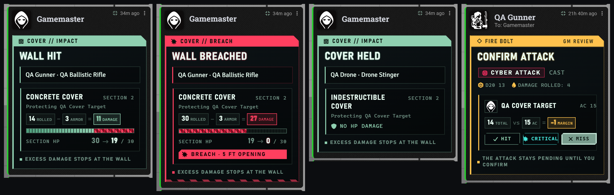

# Rules and integration reference

[← Overview](../README.md) · [Visual guides](Hardwipe-Guide.md) · [Development status](Development.md)

This page collects the details needed for adjudication or integration. Start with the illustrated feature guides for ordinary use. Public installer: **0.7.48 / Ready Set Midi 14.0.10.2**. Audited preview changes are called out in [Development](Development.md).

## Cover calculation

With Ready Set Midi 14.0.10.3 or later, ranged cover uses its built-in calculation (Simple Cover 5e's rules), worked out during each attack only:

| Check | Cover |
| --- | --- |
| From the attacker's best corner, lines to the four corners of the target's space: none blocked | No AC bonus |
| One or two lines blocked by walls or creatures | Half cover: +2 AC |
| Three or four lines blocked | Three-quarters cover: +5 AC |
| Walls hide every visibility point of the target from the attacker's eyes | Full physical cover: character cannot be hit through the wall |

Lines pass through the holes damage has opened in a wall: only the wall's solid parts block. Creatures between attacker and target block lines too (Ready Set Midi's *Creatures give cover* setting). The stray-shot impact point is where the attack's center line meets a wall, or, when that line goes through a hole, the nearest solid wall a blocked line meets.

With an older Ready Set Midi, ranged cover casts nine rays from the attacker's center to inset points across the target's footprint on the same scene level: 0–4 blocked is no cover, 5–6 half, 7–8 three-quarters, 9 full physical cover. Those rays also pass through wall holes.

Native status cover and attack-specific partial-cover reductions remain part of Midi's AC calculation. Full physical cover intercepts a shot after reactions and force-hit resolution. Melee ignores cover. Tagged ballistic glass blocks shots even when its sight/light restrictions are clear; open doors allow them through.

For a ranged weapon near miss, partial cover intercepts when the final total is at least **final AC − 5**. Through full cover, compare against **AC without cover − 5**. A natural 1 does not damage cover; a natural 20 does not bypass full cover. Range limits remain in force.

Example: base AC **15**, half cover **+2**, final AC **17**. A total of **12–16** can damage cover, **11 or less** misses, and **17+** hits the character. With full cover, **10+** can strike the wall while the character remains blocked. Wall damage still requires the GM's Apply decision.

Durability belongs to fixed five-foot intervals along the original wall. Threshold is checked against qualifying rolled damage before armor. Equal-to-threshold qualifies. Each impact is independent. Excess damage stops at cover. Scene grid scale and metric conversion determine five feet.

## Character and shield rules

Cyberware regions hold one package each. Hands, Legs, Eyes, and Arms are paired packages. Hands, Legs, and Eyes swap during a short or long rest without a Ripperdoc; every other region needs one. Installed, enabled, undamaged cyberware applies its native effects and activities. Carried, disabled, and damaged cyberware does not.

Shield Block spends the normal Midi reaction, by forcing Midi's marker. In a started combat it is available only while the Turn panel's reaction reads Ready, so with Midi's Enforce Reactions on *Do not check* a reaction in Hardwipe's ledger also prevents it; outside combat Midi's count decides. Shield HP is saved on the equipment item, clamped to 0–10. Broken shields unequip; repaired shields require explicit re-equipping. NPC zero HP does not invoke character Strikes. Three Strikes remains Dead through normal rest and Edge recovery.

## Public integration surfaces

Use the managers instead of writing flags directly so ownership, queue, service, and state rules run.

| Surface | Purpose |
| --- | --- |
| `game.hardwipe.cyberware` | Classification, state, queue installation/removal, cancel, enable, reset, repair, service access |
| `game.hardwipe.cover.inspectCover({attacker, target, activity})` | Physical ray result, fraction, and first impact |
| `game.hardwipe.cover.manageWallTypes()` | Open the in-app type manager |
| `game.hardwipe.shields.damage(item, amount)` | Change shield HP through the manager |
| `game.hardwipe.shields.heal(item, amount)` / `.repair(item)` | Recover shield durability |
| `game.hardwipe.edge` / `.strikes` / `.heat` | Character resources and scene escalation |
| `game.hardwipe.crew` | Crew maneuvers: `types()`, `rule(item)`, `primed(actor)`, `trigger(actor, effectId)`, `cancel(actor, effectId)`, `configure()` (the types window) |

| Stored data | Location |
| --- | --- |
| Cyberware category | Equipment `system.type.value = "hardwipe-<region>"` |
| Cyberware state | Item `flags["hardwipe-ruleset"].cyberware`: `version`, `installed`, `disabled`, `damaged`, `pending` |
| Wall durability | Wall `flags["hardwipe-ruleset"].cover` |
| Wall history and duplicate receipts | Scene Hardwipe flags |
| Saving-throw roster | Message `flags["hardwipe-ruleset"].saves` |
| Crew maneuver | Feat `system.type.value = "crewManeuver"`, `system.type.subtype` = a type id; the types are the world setting `hardwipe-ruleset.crewTypes` (`{list: [{id, name, payoff, fires, lasts}]}`, defaults until saved). Armed effect `flags["hardwipe-ruleset"].crew`: `item`, `type`, `stamp` (combat, round, turn, or null before a fight), with a copy of the description. CREW card message `flags["hardwipe-ruleset"].crew`: setter, firer, maneuver, type, payoff, user, round, turn |
| Linked save result | Save message `flags.dnd5e.originatingMessage` |
| Per-spell card color | Spell `flags["hardwipe-ruleset"].cardColor` |
| Turn panel ledger | Actor `flags["hardwipe-ruleset"].turnLedger`: `combat`, `round`, `turn`, `action`, `bonus`, `attacks`, `moves` (standard actions taken and what paid for them), `reaction`; cleared when the actor's turn starts |
| Roll call | D&D5e `request` message with handler `hardwipe`; `flags["hardwipe-ruleset"].request`: `kind` (`each`, `group`, `contest`), `reason`, `dc`, `showDC`, and `roll` or `contest` (`action`, `challenger`, `defender`, `challengerRoll`, `defenderRolls`), plus `applied` once the GM applies a contest's condition. Answering rolls carry `flags.dnd5e.requestResult` and `flags["hardwipe-ruleset"].requestRoll` |
| Closed, pinned, posted | Any request, save card or concentration interrupt: `flags["hardwipe-ruleset"].closed` (`reason`: `gm` or `timer`, `at`) once closed. Requests also carry `pinned` (kept past the timer) and `posted` (`combat`, `round`, `turn` when posted during combat) |
| Attack action or Action | Activity `flags["hardwipe-ruleset"].actionType`: `attack` (one attack of the Attack action) or `action` (the whole action). Unset, weapon and unarmed attacks are `attack` and everything else `action`. Only read for activities that cost an action |
| Tool card family | Tool `flags["hardwipe-ruleset"].toolFamily`: `breach`, `spoof`, `synth`, `fab`, `nav` or `signal`, to override the family read from the tool's D&D5e type |
| Edge play *(next release)* | Message `flags["hardwipe-ruleset"].edgePlay`: `play` (`reroll`, `interrupt`, `stabilize`, `execute`, `charged`), `actorId`, `userId`, and per play: Reroll `target` (`messageId`, `rollIndex`, `termIndex`, `resultIndex`, `faces`, `old`, `value`, `oldTotal`, `newTotal`, `kind`), `state` (`choosing`, `kept`, `taken`) and `ruled` (token uuid with dots as underscores → the GM's new outcome); Interrupt `combat`, `round`, `turn`, `state`, `slot`, `item`; Stabilize `strikesBefore`, `strikesAfter`; Execute `target` |
| Live Interrupt *(next release)* | Actor `flags["hardwipe-ruleset"].edgeInterrupt`: `combat`, `round`, `turn`, `state` (`ready`, `used`), `messageId`; good only on the turn it was bought |
| Applied damage log | Message `flags["hardwipe-ruleset"].applied`: entries with `targets` (`uuid`, `name`, `dv`, `dt` and `m`, the multiplier: a target that saved records ½ or 0 *(next release)*), `parts`, `kinds`, `label`, `by`, `undone` |
| Typed chat *(next release)* | Plain `base` messages with no rolls and only `core` flags, plus Smartphone Widget texts (`flags["smartphone-widget"].isSmartphoneMessage`; its `phone-message-header` line becomes the tag). Hardwipe's other messages get `themed theme-dark` on their content |
| Legendary card *(next release)* | Weapon `flags["hardwipe-ruleset"].cardIdentity`: `schema` 1, `mode` `preset` with `preset` a design (`engraved`, `holo`, `evidence`, `neon`), or `mode` `default` for the standard card. Shown on weapons at or above the world setting `hardwipe-ruleset.legendaryRarity` (a rarity key; empty is the top tier) |
| Attacks per Attack action (override) | Feature or working implant `flags["hardwipe-ruleset"].attacksPerAction`; the highest of this and Extra Attack-style features wins |

Ready Set Midi exposes `MidiQOL.hardwipeCoverBridgeVersion = 1` and the `midi-qol.computeCoverBonus`, `computeTargetAC`, `wallCoverRange`, `targetHitResolved`, and `coverAutoRollDamage` hooks. Canonical per-target resolution is persisted for GM verification. Use the Ready Set Midi companion attached to the same Hardwipe release (rebuilt by [`preview/merge-companion.py`](../preview/README.md)), which carries these hooks together with the area-spell changes; copying only a Hardwipe script is insufficient.

## Limits that matter at the table

Cover is two-dimensional within a scene level. Hardwipe does not model wall height, elevation penetration, token silhouettes, ricochets, bullet penetration, destructive map painting, or automatic Tile damage. Direct wall targeting supports ordinary weapon attack activities.

Generated sight/light helpers are module-managed and do not count as ballistic cover. Editing them manually can stop further damage or Undo until the parent is explicitly reconfigured. Undo retains up to 20 scene snapshots and refuses to overwrite intervening edits.

The audited Edge/Strikes queues serialize operations on **one client**; they are not a cross-client transaction guarantee. *(Next release.)* Edge **Reroll** writes the die through the card's author (who holds the Midi workflow) or a GM, and **Execute** runs on a GM's client, so both need one of them online. Awarding Edge is GM-only. A reroll that undoes a drop to 0 HP leaves the Strike from that drop for the GM to remove. Third-party macros and roll modules need their own compatibility checks. There is no bundled implant balance compendium, cyberpsychosis subsystem, global Power Attack, Called Shots, or Sudden Charge rule.

The [original 0.7.40 guide](archive/Hardwipe-Guide-0.7.40.md) is retained as a historical release document. Its old fallback-damage and separate critical-application descriptions are superseded by the explicitly labeled audited preview.
