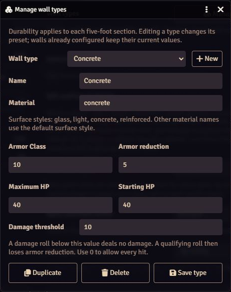
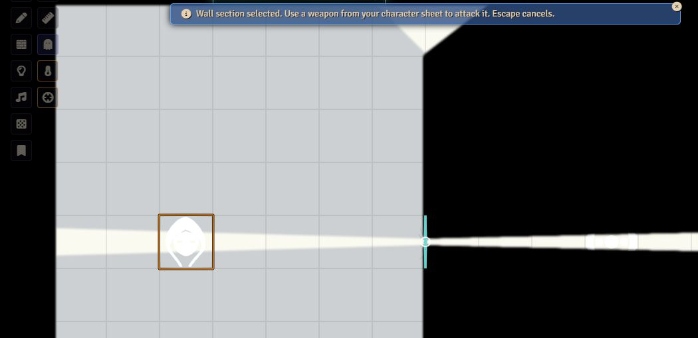
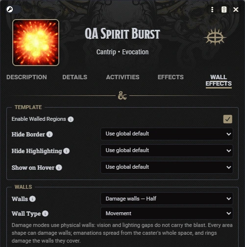
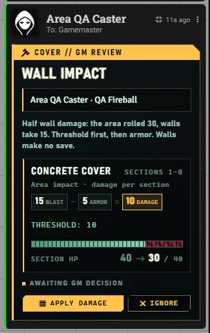
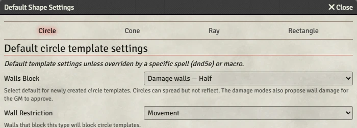
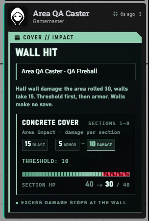
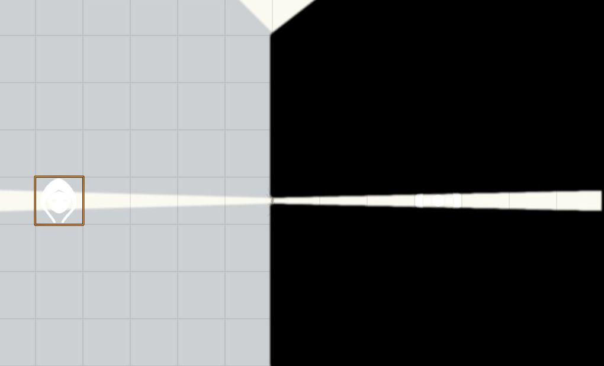

# Walls: cover, durability, glimpses, and breaches

[← Overview](../README.md) · [GM setup](GM.md) · [Combat](Combat.md) · [Exact cover math](Reference.md#cover-calculation)

## Give a wall durability

| Manage presets | Apply a type to a wall — audited preview |
| --- | --- |
|  |  |

1. Open **Game Settings → Hardwipe Ruleset → Manage wall types**.
2. Create or edit a type with its material appearance, AC, maximum HP, starting HP, armor reduction, and damage threshold.
3. Select the scene wall and assign that type. In the public release, use **Wall Controls → Configure wall cover**. The audited preview also puts a compact Hardwipe section at the **bottom** of the native Wall Configuration window.
4. Save. Enable **Show damage and glimpses** for visible wear and sight/light slits.

Untagged solid walls are **indestructible cover**. A type existing in the manager does not assign it to every scene wall. Explicitly apply a type to each intended wall or selection.

| Initial type | AC | HP per five-foot section | Armor per impact | Damage threshold |
| --- | ---: | ---: | ---: | ---: |
| Glass | 10 | 10 | 0 | 0 |
| Light partition | 10 | 20 | 2 | 3 |
| Concrete | 10 | 40 | 5 | 10 |
| Reinforced wall | 10 | 80 | 10 | 15 |

These are editable presets. Create, duplicate, rename, or delete types in-app. Editing a preset does not retroactively change configured walls; reapply it to update them. Existing section damage remains unless **Reset section HP to starting HP** is selected. Lowering maximum HP clamps current HP.

## Threshold first, armor second

**Below the damage threshold, the wall takes no damage at all.** At or above it, subtract armor from the qualifying damage, then reduce that section's HP by the remainder.

For threshold **10** and armor **5**:

| Rolled damage | Section HP lost |
| ---: | ---: |
| 9 | 0 — below threshold |
| 10 | 5 |
| 14 | 9 |

Separate attacks do not accumulate toward the threshold. Healing and temporary HP do not damage walls. Old flagged walls without a threshold retain zero until reconfigured.

## Near misses can strike cover

Ranged attacks sample physical walls between the attacker and target. Melee attacks ignore cover. Partial cover adds AC; full physical cover prevents the shot from hitting the character, including on a natural 20.

For ranged weapon attacks, a partial-cover miss within **5 points below final AC** can strike the wall. Through full cover, compare the attack to **AC without cover minus 5**. A natural 1 never damages cover. The [rules reference](Reference.md#cover-calculation) gives the ray counts and a worked example.

## The GM approves every impact

The private review shows raw damage, threshold/armor context, section HP, proposed loss, and a breach warning. **Apply damage** changes HP and geometry; **Ignore** closes the proposal without changing the wall. This applies even to attacks rolled by the GM. A roll alone never changes wall durability.

If the attack or damage roll changes while the proposal is still waiting (a reroll, a bonus, critical dice), the attacker's client withdraws it and posts a new one from the current rolls. Once the GM has applied or ignored it, the proposal stands: to change wall damage already applied, use **Undo last wall damage** and roll again.

Repeated approvals cannot apply one impact twice. Moved tokens, changed geometry, or changed durability can make a proposal stale and stop application. Pending review remains available after reload. Direct wall approval requires the GM to view that scene.

## Target a wall directly

1. Control one character you own.
2. Choose **Target wall** in Token Controls and click a visible wall.
3. Use an ordinary weapon attack from the character sheet.
4. On a hit against the wall's AC, resolve weapon damage and wait for GM Apply/Ignore.

The marker identifies the five-foot section. Melee needs reach; ranged attacks respect maximum range. **Audited preview:** long range gives a source-specific disadvantage hint and leaves roll mode to the player or GM.

Escape, movement, switching controlled characters, or changing scenes cancels selection. Creature targets are cleared for that use. An intervening intact wall blocks selecting another wall behind it; hidden secret doors and out-of-vision walls cannot be selected. Direct targeting covers ordinary weapon attacks, not spell attacks or area templates.

## Area spells damage walls

| Set it on the spell | The GM's review |
| --- | --- |
|  |  |

Hardwipe bundles Walled Regions for area placement and wall clipping. Open an area spell's **Wall Effects** tab, check **Enable Walled Regions**, and set **Walls** to **Damage walls — Half** (a Fireball-style blast) or **Damage walls — Normal**. A placed Region's **Wall Effects** section has the same choices.

**A default for every spell of a shape.** Open **Game Settings → Hardwipe Ruleset → Default Shape Settings**, pick the shape's tab (circle, cone, ray or rectangle), and set **Walls Block** to a damage mode. Every spell of that shape left on **Use global default** then damages walls, with no per-spell setup.

| Mode | Area behavior | Wall durability |
| --- | --- | --- |
| Global default | Uses the shape's default | Damage when that default is a damage mode |
| Do not block template | Original area passes through walls | No area wall damage |
| Block template | Area stops at walls | No area wall damage |
| Reflect/Spread template | Existing Walled Regions reflection or spread | No area wall damage |
| Damage walls — Normal | Area stops at standing physical walls | Proposes the full damage roll |
| Damage walls — Half | Area stops at standing physical walls | Proposes half the damage roll, rounded down |

Every dnd5e area shape can damage walls:

| Shape | Walls it reaches |
| --- | --- |
| Circle (sphere, cylinder), cone, line, cube | Walls inside the area with a clear line to its point of origin. An intact wall shields the walls behind it. |
| Emanation (an aura around the caster) | Walls inside the area with a clear line to any point of the caster's space, so a wall beside the caster is hit even where its center can't see it. |
| Ring | The walls inside the ring's band, wherever they face. |

Emanations and rings keep their full drawn area on the map, because Walled Regions can't trim those shapes; which creatures they catch follows Ready Set Midi's auto-target setting. Emanations and rings take their damage mode from the spell itself; the per-shape defaults cover circles, cones, lines and cubes.

For a Fireball-style effect, choose **Damage walls — Half**. Walls do not make a creature saving throw. Hardwipe starts with the original damage roll, applies the selected wall multiplier, checks the damage threshold, then subtracts armor. With threshold **10** and armor **5**:

| Original roll | Mode | Damage checked against threshold | HP lost per exposed section |
| ---: | --- | ---: | ---: |
| 18 | Half | 9 | 0 |
| 20 | Half | 10 | 5 |
| 30 | Half | 15 | 10 |
| 30 | Normal | 30 | 25 |

Each exposed five-foot section receives one proposed impact. Overlapping placements in the same cast do not hit a section twice. An intact wall shields walls behind it, including walls that have optical glimpse gaps. Destroying the front wall does not send that same blast onward to another wall. Damage modes always use physical walls; the optical Wall Type selector is disabled for these modes.

The GM receives one private **Apply damage / Ignore** review for the cast, including all affected sections, under the caster's name. Wall HP, surface marks, and geometry wait for approval. Changing the source area, the damage roll, wall settings, or blockers invalidates the old proposal; for an emanation, so does the caster moving. A pending instantaneous area is retained so the GM can verify it. When Ready Set Midi's **auto-remove instantaneous templates** is on, the area is removed once the GM decides; otherwise remove it by hand as usual. **Undo last wall damage** restores the cast's wall changes together.

Use this bundled implementation with standalone Walled Regions and Walled Templates disabled. Existing `walled-regions` item and Region flags remain compatible. The source and bundled licenses are in [vendor/NOTICE.md](../vendor/NOTICE.md).

Area wall damage and ranged wall cover both need the Ready Set Midi companion attached to the same Hardwipe release; Hardwipe's manifest installs it. It records the placed area on the spell's card and keeps a pending instantaneous area on the map until the GM decides, and it carries Hardwipe's ranged-cover hooks. Direct non-area spell attacks against walls remain outside the wall-targeting tool's supported actions.

## Damage opens a glimpse before a breach

Every hit that damages a section leaves its own hole, sized by the damage it did: a hit for a quarter of the section's HP opens a narrow hole, a hit for three quarters opens about two thirds of the section. The first hole sits on the impact; later ones scatter across the section, clear of the holes already there, so a big hit reads as one wide hole and several small hits as several small ones. Each hole gets its own surface mark, heavier as the section's HP falls. Every client draws the same holes.

| Section HP | Surface | Vision and light | Movement and shots |
| --- | --- | --- | --- |
| Full | Intact | Original restrictions | Physical wall remains |
| Damaged | A mark per hit | A hole per hit, sized by its damage | Physical wall remains |
| Zero | Five-foot breach | Destroyed interval open | Destroyed interval removed |

Sections damaged before 0.7.43 have no per-hit record and read as a single hit for all the damage taken.

These are genuine Foundry vision and light openings. Players can glimpse tokens and illumination through the crack using normal vision rules. **Seeing through damage does not allow shooting through it** while the physical wall remains. Surface marks follow current vision and do not reveal unseen damage through explored fog.

At zero HP, Hardwipe removes that fixed five-foot interval and keeps the remaining segments. A short end section removes only the wall portion that exists. Door data, restrictions, direction, level membership, and adjacent section damage are preserved. Excess damage from the breach-causing shot never transfers to the character behind it.

## Undo and map artwork

**Undo last wall damage** restores HP, marks, sight/light boundaries, and breached geometry together, including after reload. Up to 20 snapshots are kept per scene. If someone has since edited the affected wall or its generated helpers, Undo stops to avoid overwriting their work.

Turning off damage and glimpses restores original sight/light restrictions and removes the visual helpers. Treat generated boundaries as module-managed; configure the physical parent wall.

Hardwipe changes Foundry wall geometry and overlays marks. It does not repaint the scene background. A wall drawn in the map art can remain visible after its collision boundary is breached. Cover is a two-dimensional footprint calculation on the scene level, without wall height, bullet penetration, or ricochets.
